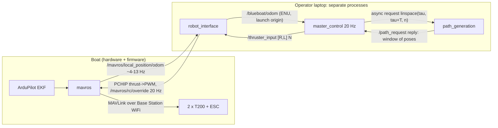

# BlueBoat-Control — technical report and scientific justification dossier

**Module:** `BlueBoat-Control` (ROS 2 packages `blueboat_control`, `blueboat_description`,
`blueboat_interfaces`; tools `log_reviewer/`, `controller_comparison/`).
**Tree described:** branch `claude/determined-clarke-a21pvr` at `1863ab8` ("Optimize Control:
simplify nodes, trim comments, condense Claude context"), working tree clean.
**Date:** 2026-11-03 (from `date +%F`).
**Thesis:** *Autonomous Aspect-Aware Side-Scan Sonar Survey on a Small Unmanned Surface Vehicle.*

**Readers.** (1) A reviewer with no access to the code, who compares this module with the
state of the art. (2) The thesis author, who must answer "why this way?" for each choice.

**Markers used throughout.**

| Marker | Meaning |
|---|---|
| **[VERIFIED]** | Read in code, or computed or run in this session (command named). |
| **[DOC]** | Taken from a document or code comment, not re-checked. |
| **[UNCERTAIN]** | Unclear, contradictory or never established. |
| **[full] / [abs] / [unread]** | Evidence level of a *reference*: full text read / abstract only / title and metadata only. A reference marked "[full] per `docs/REFERENCES.md`" was read in full in an earlier session (recorded in that file), **not in this one**. |

Every path below is relative to the module root `BlueBoat-Control/` unless it names another
module. `master_control.py` means `blueboat_control/src/master_control.py`. Line numbers are
from `1863ab8`.

---

## 0. Summary

1. **What it does.** Control makes the BlueBoat follow a planned path (or a point) and logs
   the result. A path is a function `t → (x, y, yaw)`. A **governor** advances the path
   parameter τ only as fast as the boat keeps up. One of three controllers (**PID**, **LoS**,
   **MPC**) turns the error into two thruster forces, which are saturated uniformly to ±20 N
   and sent to ArduPilot as RC-override PWM at 20 Hz. All of it runs on the operator laptop.
2. **Thesis role.** It is the execution layer for every survey condition of the policy
   comparison (E4), for the real-water demonstration (E6) and for the heading-response runs
   (E3). It owns the Replanner's entry point, the live path update (`/blueboat/update_path`).
3. **Strongest point.** Field evidence exists: 12 real runs on 2026-09-07 (4 routes × 3
   controllers) plus 24 Gazebo repeats. MPC held 0.24–0.41 m mean cross-track error and kept
   99–100 % of the planned speed. The governor's effect on speed is predicted from the measured
   trailing distance to within 5 % in all 12 field runs.
4. **Weakest point.** The plant models. The simulator's hull coefficients are **BlueROV2
   (underwater ROV) values**, not BlueBoat values. The real-boat MPC model has **no recorded
   provenance**: its surge added mass is 167 % of the hull mass. In simulation each metre
   costs 2–3× the thrust it costs on the real boat.
5. **Riskiest point.** The guidance law acts on **heading, not course**, with no sideslip,
   current or offset compensation in any controller (PID has a small integral only). The
   comparison is also n = 1 per cell, at one site, under wind that varied by a factor of two.
   The gains flown on 2026-09-07 are no longer the defaults: PID and LoS were retuned on
   2026-10-27.
6. **Principles:** 13 (STRONG 1 · MODERATE 5 · WEAK 6 · NONE 1). **Gate (2026-11-03):** the
   ROS-free suites pass, 102/0, 24/0 and 18/0 with 11 checks skipped. The ROS-dependent harness
   (`mc_harness.py`), the log-reviewer smoke test and the interface guard **could not run in
   this container** (§6.1).
7. **Doc corrections made:** 4, in `FIELD_TUNING.md` and `blueboat_control/src/TRAJECTORY_SYSTEM.md`
   (Appendix B).
8. **Not in this module:** survey generation, belief, replanning, sonar processing, state
   estimation (ArduPilot's EKF provides it) and the operator GUI.
9. **Literature position.** The cascade of lookahead LOS guidance, a path parameter and
   PID/MPC is standard marine practice (Breivik & Fossen 2004; Skjetne et al. 2004;
   Faulwasser & Findeisen 2016). Drift compensation (ILOS/ALOS), offset-free MPC, input-rate
   penalties and anti-windup are the standard additions. This module has none of them.
10. **What the thesis may claim safely:** single-site, single-day field tracking figures with
    their caveats; that the governor bounds the reference; that all conditions share one
    execution path. **What it must not claim:** that simulated time, energy or tracking
    numbers transfer to the real boat (§7.2).

---

## 1. Module position (Step A)

### 1.1 What it serves in the thesis

| Thesis element | How Control serves it | Marker |
|---|---|---|
| **Scientific spine step 5–7** ("multi-aspect revisit is a detection requirement"; automating the revisit decision) | Control does not decide anything. It executes the headings and lines the Replanner chooses, so its heading and cross-track accuracy bound how well a *planned* aspect equals the *achieved* aspect. | [DOC] `project_synthesis.md` §2; [VERIFIED] code scope below |
| **RQ1–RQ4** | `project_synthesis.md` (this tree, revision of 2026-10-20) does **not** list RQ1–RQ4 by number. Its §2 and §4.1 hold the scientific goal and the headline claim. The mapping below therefore uses evidence layers and deliverables only. | [UNCERTAIN] — RQ numbering not found in the synthesis on this machine |
| **E3** heading-response experiment (beach; 4–5 objects × 8–12 headings at fixed ground range) | Control flies the straight passes. Its heading error sets the aspect uncertainty, and its cross-track error sets the ground-range uncertainty of each look. | [DOC] synthesis §7.2 |
| **E4** policy comparison (Gazebo) | "All four conditions are generated by the Replanner and sent through Control's live path update, so the baseline and the adaptive variants share one execution path." Control is the common actuator, and any bias it has is shared by baseline and adaptive runs. | [DOC] synthesis §7.3 |
| **E6** real-water closed-loop demo | Requires the live path update on water. It has never been tested there. | [DOC] synthesis §7.5; `.claude/TODO.md` |
| **§8.4 metric "Repositioning precision for revisit"** | Control's tracking error *is* this metric's floor. | [DOC] synthesis §8.4 |
| **§8.4 metric "Energy cost per validated object"** | Control logs commanded thrust (`.npy` `u1,u2`; CSV). Thrust per metre is computed offline (§3.13). | [VERIFIED] `master_control.py:_record_monitoring` |
| **D5** "Mission interface — path following and live path update" | Built. Path following was field-tested on 2026-09-07; the live path update was tested in Gazebo only. | [DOC] synthesis §9 |

### 1.2 Place in the pipeline

```
upstream                                   THIS MODULE                                  downstream
────────                                   ───────────                                  ──────────
MCS Pattern Designer ──(trajectory YAML)──► path_generation (/path_request server)
Replanner (planned) ──(/blueboat/update_path)─► master_control ──/thruster_input──► robot_interface ──/mavros/rc/override──► ArduPilot ──PWM──► 2× T200
ArduPilot EKF ──/mavros/local_position/odom──► robot_interface ──/blueboat/odom──► master_control, SSS processor, GCS, MCS
MCS ──input_str / manual_target / arrow_thrust / run_command──► robot_interface / master_control
Gazebo (sim) ──odometry bridge──► /blueboat/odom ;  /thruster_input ──► simulation_interface ──► Gazebo Thruster plugin
```

Outputs consumed by others: `/blueboat/odom` (sonar processor, GCS, simulator sonar, MCS),
`/monitoring_data` (MCS), `/blueboat/path_progress` (future Replanner), position CSV, `.npy`
and run bags (log reviewer, analysis). **[VERIFIED]** topic wiring in `master_control.py:__init__`
and `robot_interface.py:__init__` (lines 125–150, 187–260).

### 1.3 What it explicitly does not do

| Not done here | Owner | Marker |
|---|---|---|
| Generate survey patterns (lawnmower, arcs, two-pass baseline) | MCS Pattern Designer (fixed missions), planned Replanner (every E4 condition) | [VERIFIED] `path_generation.py` only evaluates; `BlueBoat-MCS/mcs/designer/sampling.py` samples |
| Estimate the vehicle state (no Kalman filter, no observer) | ArduPilot EKF via MAVROS (real); Gazebo `OdometryPublisher` (sim) | [VERIFIED] `robot_interface.py:odom_callback` re-zeros the position only |
| Decide where to revisit, from which heading | Replanner (planned, not built) | [DOC] synthesis §5.1 |
| Sonar processing, georeferencing, pinging | `blueboat_sss`, GCS | [DOC] root `CLAUDE.md` §1 |
| Sea state, simulated sonar | `BlueBoat-SSS-Sim` | [DOC] root `CLAUDE.md` §4.1 |
| Link-loss return-to-home | `link_guardian/` (ArduPilot Lua) | [DOC] root `CLAUDE.md` §1.1 |
| Feasibility of a replanned path (curvature, speed versus thrust) | Replanner. Control only applies sanity bounds | [DOC] `docs/REFERENCES.md` R2 §V.A |

### 1.4 Scientific content versus engineering

**Scientific** (method, model, law or threshold choices, §3): the plant model, the reference
representation, the governor, LOS guidance, the PID cascade, the LoS law, the MPC problem,
thrust allocation and saturation, the thrust-to-PWM model and deadband, the point-following
law, feedback timing, the path-update acceptance rules, and the evaluation method of the
September comparison.

**Engineering** (Appendix A): run sessions, E-STOP latch, safe shutdown, servo remapping
(`param_set`), RC-override streaming, watchdogs, path-server uniqueness, logging, run bags,
bag replay, arrow keys, autopilot arming for the link guardian.

---

## 2. Interface contract and architecture (Step B)

### 2.1 ROS interface table

Rates are nominal unless a measured value is given. Frames are defined in §2.5. Default QoS
means reliable, volatile, depth 10.

| Name | Type | Dir (Control) | QoS | Rate | Frame | Units | Other side | Marker |
|---|---|---|---|---|---|---|---|---|
| `/mavros/local_position/odom` | `nav_msgs/Odometry` | in (`robot_interface`) | BEST_EFFORT, depth 10 | **~4 Hz** measured in every 2026-10-27 run bag; **~13 Hz** once the sonar processor requests message intervals | pose: MAVROS local ENU; twist: body (`base_link`) | m, rad, m/s, rad/s | MAVROS / ArduPilot EKF | [DOC] root `CLAUDE.md` §4.4; QoS [VERIFIED] `robot_interface.py:136-139` |
| `/mavros/imu/data`, `/mavros/global_position/global`, `/mavros/state` | `Imu`, `NavSatFix`, `mavros_msgs/State` | in | BEST_EFFORT (first two), default | as autopilot | — | — | MAVROS | [VERIFIED] `robot_interface.py:137-140` |
| `/blueboat/odom` | `nav_msgs/Odometry` | out (`robot_interface`, real); in (`master_control`) | default 10 | = MAVROS rate (real); **20 Hz** (sim bridge) | local ENU, origin = boat at launch (real) / Gazebo origin (sim); yaw absolute ENU | m, rad; twist body-frame | `master_control`, SSS processor, GCS, MCS, simulator sonar | [VERIFIED] `robot_interface.py:odom_callback`; sim rate [DOC] `blueboat_description/CLAUDE.md` |
| `/thruster_input` | `std_msgs/Float32MultiArray` `[right, left]` | out (`master_control`) | default 10 | **20 Hz** (every tick, zero on early return) | — | N | `robot_interface` (20 Hz), `simulation_interface` (**10 Hz** apply), MCS | [VERIFIED] `master_control.py:timer_callback`, `simulation_interface.py:95` |
| `/mavros/rc/override` | `mavros_msgs/OverrideRCIn` | out (`robot_interface`) | default | 20 Hz | — | µs PWM, ch1 right, ch3 left | ArduPilot | [VERIFIED] `robot_interface.py:manualMove`, `send_rc_override` |
| `/monitoring_data` | `Float32MultiArray` `[t,x,y,psi,x_d,y_d,psi_d,u1,u2]` | out | default 10 | 20 Hz while something is targeted | world (local ENU) in every branch | s, m, rad, N | `robot_interface` (CSV), MCS | [VERIFIED] `master_control.py:_record_monitoring` |
| `/controller_target` | `Float32MultiArray` | out (pinger branch only) | default 10 | 20 Hz | body | m | `robot_interface` (stored, unread) | [VERIFIED] `_pinger_command` |
| `/blueboat/pinger_coordinates` | `Float32MultiArray` `[x,y,z]` | out (`robot_interface`), in (`master_control`) | default 10 | odom rate | body | m | `master_control`, GCS, MCS | [VERIFIED] `robot_interface.py:odom_callback` |
| `/blueboat/controller_ready` | `std_msgs/Bool` | out (interface nodes), in | real volatile 10; sim TRANSIENT_LOCAL 1 | republished every 1.0 s | — | — | `master_control`, MCS | [VERIFIED] `simulation_interface.py:91`; [DOC] root §4.1 |
| `/blueboat/manual_target` | `Float32MultiArray` `[x,y]` | in | default 10 | event | world | m; `[0,0]` = resume sentinel | MCS, GCS | [VERIFIED] `manual_target_callback` |
| `/blueboat/arrow_thrust` | `Float32MultiArray` `[right,left]` or `[]` | in | default 10 | 20 Hz while engaged | — | N | MCS | [VERIFIED] `arrow_thrust_callback` |
| `/path_request` | srv `blueboat_interfaces/RequestPath` (`Float32MultiArray` → `nav_msgs/Path`) | client (`master_control`); server (`path_generation`) | service | one request in flight per tick, async | `world` | path seconds → poses | `path_publisher`, MCS, GCS (other clients) | [VERIFIED] `_mission_reference_step` |
| `/blueboat/update_path` | srv `blueboat_interfaces/UpdatePath` | server (`master_control`) | service | on request | `world` | `[t,x,y,yaw]` samples | future Replanner; tests | [VERIFIED] `master_control.py:_init_path_update`; contract [DOC] `docs/PATH_UPDATE_INTERFACE.md` |
| `/blueboat/path_progress` | `String` JSON `blueboat_path_progress/1` | out | default | 10 Hz + on change | — | τ in path seconds | future Replanner | [DOC] root §4.1 |
| `/blueboat/path_update_event` | `String` JSON | out | reliable, depth 50 | per event | — | — | interface nodes (path log), bag | [VERIFIED] `robot_interface.py:146` |
| `/blueboat/run_command`, `/run_state`, `/run_log` | `String` JSON | in / out / out | default 10 | event / 1 Hz / 1 Hz | — | — | MCS (real-robot sessions only) | [VERIFIED] `master_control.py:118-121` |
| `/blueboat/input_str`, `/param_str`, `/param_ready`, `/param_mode` | `String` / `Bool` | various | default 10 | event / 1 Hz | — | — | MCS, `param_set` | [VERIFIED] `robot_interface.py:132-134` |
| `/uw_gps_data` | `Float32MultiArray` (19 values) | out (`uwgps_log`) | default | USBL poll | — | — | `robot_interface`, MCS | [DOC] root §4.1 |
| `/set_path`, `/pose_arrow` | `nav_msgs/Path`, `Marker` | out | default | 1 Hz republish, 5 s refresh / 20 Hz | world | — | RViz, GCS (sim only) | [VERIFIED] `path_publisher.py:43` |

No ROS action, no `/diagnostics`, no TF consumed. **[DOC]** root `CLAUDE.md` §4.6–§4.7.

### 2.2 Message fields read or written by the control loop

| Field | Meaning | Units | Sign convention | Marker |
|---|---|---|---|---|
| `odom.pose.pose.position.{x,y}` | boat position in local ENU | m | x east, y north | [VERIFIED] `cf.odometry` |
| `odom.pose.pose.orientation` → yaw ψ | heading of the body x-axis | rad | 0 = east, counter-clockwise positive, absolute ENU (not re-zeroed since 2026-08-31) | [VERIFIED] `robot_interface.py:odom_callback` |
| `odom.twist.twist.linear.{x,y}` = (u, v) | surge, sway | m/s | body frame: x forward, y port (left) | [VERIFIED] passed through untouched; [DOC] measured body-frame against mavros 2.14.0 (`.claude/CLAUDE.md` N3) |
| `odom.twist.twist.angular.z` = r | yaw rate | rad/s | CCW positive | [VERIFIED] |
| `/thruster_input[0]`, `[1]` | right (starboard) and left (port) thrust | N | + forward | [VERIFIED] allocation `B` column 0 = +r moment; URDF `thruster1` at y = −0.295 (starboard) |
| `/monitoring_data[4:7]` = (x_d, y_d, ψ_d) | the **first** pose of the current reference window (`_reference_pose`) in every branch | m, rad | world | [VERIFIED] `master_control.py:76-89` |
| `/mavros/rc/override.channels[0]`, `[2]` | right, left PWM | µs | 1500 neutral; right forward > 1500; **left mirrored** `3000 − PWM` | [VERIFIED] `manualMove` |
| Path pose `header.stamp` | the path parameter of that pose (`path_stamp.encode`), used to reject foreign servers | path seconds | — | [VERIFIED] `accept_path` |

### 2.3 Parameters that change results

The full register is §7.1. The main knobs are all declared in
`master_control.py:_declare_tuning_parameters` (lines 377–524) and read **once, at node
construction** [VERIFIED]. Real and simulation defaults are selected by the `simulation`
parameter (`BlueBoat_launch.py:58` sets False, `Sim_launch.py:86` True) [VERIFIED].

### 2.4 Files read and written

| File | Format and schema | Location rule | Write-once? | Marker |
|---|---|---|---|---|
| Trajectory YAML (in) | `blueboat_trajectory/1`: `format`, `name`, `loop`, `points: [[t s, x m, y m, yaw rad], …]` dense | `trajectory:=from_yaml:<abs path>`; session file `~/.config/blueboat_mcs/trajectories/.session/run.yaml` | no (watched, reloaded on mtime change) | [VERIFIED] `yaml_trajectory.py:__init__`, `path_generation.py:_maybe_reload_yaml` |
| Controller log `.npy` (out) | 2-D array; row 0 = header strings `['t','x','y','psi','x_d','y_d','psi_d','u1','u2']`, so **every cell is a string** (cast back on load); targets world-frame | `<root>/data/{ctrl}_data/{date}-{ctrl}_{real|simulation}_data.npy` | name claimed `O_EXCL`; file rewritten every 2 s during the run | [VERIFIED] `master_control.py:NPY_HEADER`, `_reserve_npy`, `save_monitoring` (2.0 s timer, line 142) |
| Position CSV (out) | two legend rows (description, unit) + header; 27 columns (no pinger) or 39 (pinger), filled by name; logged every **0.33 s** (~3 Hz) | `<root>/data/Robot_data/{date}-{note}-poslog.csv`, filed into `Robot_data/<stem>/` at run end | yes (CM-7) | [VERIFIED] timer `robot_interface.py:188`; schema [DOC] `robot_log_schema.py` docstring |
| `-origin.yaml` sidecar | `latitude`, `longitude` of the local-ENU origin, `yaw0_rad` (provenance only) | beside the CSV | yes | [VERIFIED] `write_origin_sidecar` |
| Run bag (mcap), `-path.yaml`, `-pathlog.csv` | see `.claude/CLAUDE.md` §6 | run folder | yes | [DOC] |
| acados solver cache | generated C, `acados_ocp.json` | `$ROS_HOME/blueboat_control/mpc` | regenerated when the OCP changes | [VERIFIED] `ur_mpc.py:acados_build_dir` |

`<root>` = `data_dir` parameter → `$BLUEBOAT_DATA_DIR` → sourced workspace → working
directory [DOC] `custom_functions.data_root`.

### 2.5 Frames and conventions

| Frame | Origin | Axes | Used for | Marker |
|---|---|---|---|---|
| **World / local ENU** ("world") | Real: boat position at the first MAVROS odom of the launch. Sim: Gazebo world origin | x east, y north, z up | path, `/blueboat/odom` pose, `/monitoring_data`, manual target | [VERIFIED] `robot_interface.py:odom_callback` (subtracts `x0,y0,z0`; yaw untouched) |
| **Body** | hull reference point (`base_link`) | x forward, y port (left), z up | twist (u, v, r), pinger vector, `/controller_target`, `solve_LoS` input | [VERIFIED] `frame_math.inRobotFrame` used before `solve_LoS` |
| **Path frame** (Serret–Frenet-like, at the reference pose) | reference pose | along-track along the path tangent γ_p, cross-track to its left | e_along, e_y | [VERIFIED] `path_progress_errors`, `los_guidance` |

- **Heading ψ:** radians, ENU, 0 = east, counter-clockwise positive. Its source is ArduPilot's
  EKF yaw (compass, IMU and GPS fused), via MAVROS's NED→ENU conversion, so it is **true**
  north-referenced to the extent the EKF uses magnetic declination [UNCERTAIN: the autopilot's
  declination setting is not visible from this repository].
- **Port / starboard:** `thruster1` = right = starboard = `/thruster_input[0]`; body +y = port.
  The sonar's own convention (+y = port) agrees [DOC] root `CLAUDE.md` §4.6.
- **Time base.** The control loop is a ROS timer at `control_dt` = 0.05 s. On the real launch
  `master_control` has `use_sim_time: False` (`BlueBoat_launch.py:63`), so it runs on the wall
  clock. In `Sim_launch.py` the launcher default `use_sim_time = True` applies, so the timer
  is paced by Gazebo's `/clock` [VERIFIED by reading the launch files]. In both, timeouts and
  the `.npy` `t` column use `time.time()` (wall clock) [VERIFIED] `timer_callback`. The
  governor advances τ by the **nominal** `dt` per tick, not by measured elapsed time
  [VERIFIED] `advance_governor`.
- **Path parameter τ** is in "path seconds". It equals wall time only when the governor factor
  is 1.

### 2.6 Data flow (one tick)



Inside `master_control.timer_callback` (lines 532–610) [VERIFIED]:

```
ready? else publish [0,0]                              (every early return publishes zero)
state s = [x, y, psi, u, v, r] from the latest /blueboat/odom (zero-order hold)
reference step: collect async reply -> accept_path -> window W; if W fresh: governor(e_along) -> tau
                issue next request linspace(tau, tau + path_time, path_steps)
command: arrows > manual target > path following (MPC | PID | LoS) > replanner hold > pinger > none
publish_thrust: uniform scaling to +/- thrust_limit  -> /thruster_input
record: /monitoring_data, append a .npy row (only during a run)
```

### 2.7 File map

| File | One line | Marker |
|---|---|---|
| `blueboat_control/src/master_control.py` | The node: governor, guidance laws, controller dispatch, run session, path-update service | [VERIFIED] |
| `blueboat_control/src/PID/PID.py` | `PID` (no anti-windup), `ThrustAllocator` (pseudo-inverse + uniform scaling), `PIDLoS` cascade | [VERIFIED] |
| `blueboat_control/src/MPC/ur_mpc.py` | acados model (3-DOF), OCP, `solve` with heading unwrapping and failure recovery | [VERIFIED] |
| `blueboat_control/src/MPC/uvr_mpc.py`, `*_control.py` | 3-thruster variant and standalone MPC nodes; launched by nothing | [DOC] |
| `blueboat_control/src/_custom_libraries/path_generation.py` | `/path_request` server; built-in shapes; `from_yaml` with file watcher | [VERIFIED] |
| `…/yaml_trajectory.py` | Dense `[t,x,y,yaw]` lookup, linear interpolation, short-way yaw, clamp or loop | [VERIFIED] |
| `…/custom_functions.py` | `compute_target` (two-pose finite differences), `odometry`, thrust→PWM table | [VERIFIED] |
| `…/thrust_limits.py` | `scale_to_limit`: one scale factor for the thrust pair | [VERIFIED] |
| `…/frame_math.py` | world↔body transforms | [DOC] |
| `…/path_update.py` | ROS-free decision core of the live path update (17 refusal codes) | [VERIFIED] code names at lines 61–81 |
| `…/path_stamp.py` | Encodes τ in pose stamps to reject a second path server | [DOC] |
| `…/poslog_report.py` | Files a finished run; PNG report; metrics for the log reviewer | [DOC] |
| `blueboat_control/src/robot_interaction/robot_interface.py` | MAVROS bridge: odom re-origin, thrust→PWM, RC override, E-STOP, CSV, run bags | [VERIFIED] |
| `…/param_set.py` | SERVO1/3 function and GCS sysid switching between `default` and `override` | [DOC] |
| `blueboat_control/src/simulation_interface.py` | Gazebo thrust bridge at 10 Hz, readiness, the same CSV | [VERIFIED] |
| `blueboat_control/src/bag_replay.py`, `…/replay_attitude.py` | Kinematic Gazebo replay of a run bag | [DOC] |
| `blueboat_description/urdf/*.xacro` | Hull: 16.01 kg, Izz 5.6403 kg·m², BlueROV2 hydrodynamics, thrusters at (−0.488, ∓0.295, −0.025) m | [VERIFIED] |
| `controller_comparison/` | September comparison report (TeX, PDF), `metrics_all.csv` (36 runs); **not here:** `analyze.py`, `verify.py` | [VERIFIED] directory listing |
| `test/` | path-update unit tests, bag-replay tests, deterministic harness, Gazebo tests | [VERIFIED] |

### 2.8 Threading and timing

| Element | Rate or period | Late or missing input | Marker |
|---|---|---|---|
| `master_control` executor | single-threaded rclpy; control timer `control_dt` = 0.05 s | Odom is held (zero-order hold). On the real boat it is refreshed at ~4 Hz, so ~4 of 5 ticks reuse the same pose (~13 Hz after 2026-10-27). | [VERIFIED] loop; rates [DOC] root §4.4 |
| `/path_request` | one asynchronous request in flight; the reply is used on a later tick (window 1–2 ticks stale) | No reply within `path_request_timeout` (1.0 s) → re-issue. Window older than `path_stale_timeout` (1.0 s) → τ **held**, not advanced. | [VERIFIED] `_mission_reference_step` |
| Foreign or mismatched reply | — | rejected (`accept_path`: pose count, τ stamp, or a geometric jump check) | [VERIFIED] |
| MPC solve | inside the tick; solve time logged if > 0.5·dt (25 ms) | failure → reset, cold re-seed, one retry, else **zero thrust** (not the stale iterate) | [VERIFIED] `ur_mpc.solve`, `_path_following_command` |
| MPC rebuild between session runs | worker thread (`ThreadPoolExecutor`, 1 thread) | the loop keeps 20 Hz; `start` refused until built | [DOC] `src/CLAUDE.md` §4 |
| `.npy` write | 2.0 s timer | only rows added since the last write | [VERIFIED] |
| `robot_interface` | 20 Hz thrust timer; CSV 0.33 s | `/thruster_input` silent > 0.5 s → neutral thrust (not a disarm) | [VERIFIED] `thruster_input_stale` |
| `simulation_interface` | **10 Hz** thrust application | same watchdog | [VERIFIED] `simulation_interface.py:95,166` |
| Arrow stream | 20 Hz | older than 0.5 s → zero thrust, arrow control stays engaged | [VERIFIED] `_compute_command` |

The sim applies thrust at 10 Hz and its odometry arrives at 20 Hz. The real boat applies
thrust at 20 Hz and its odometry arrives at 4–13 Hz. **The two loops are not timed the same
way** (§6.5).

---

## 3. Principles (Step C, pipeline order)

Order: model (used by MPC and the simulator) → reference → governor → guidance → the three
controllers → allocation and saturation → actuator map → point law → feedback timing →
path-update rules → evaluation.

| # | Principle | Support | Alignment |
|---|---|---|---|
| P01 | 3-DOF manoeuvring model and its coefficients | WEAK | DIVERGES (coefficients) |
| P02 | Path as a time-parameterised function; reference window by finite differences | MODERATE | COMMON |
| P03 | Progress-based speed governor of the path parameter τ | MODERATE | UNCOMMON BUT DEFENSIBLE |
| P04 | Lookahead LOS guidance on heading, Δ = 2.5 m | STRONG | DIVERGES (heading, not course; no drift compensation) |
| P05 | PID cascade with speed feedforward | WEAK | DIVERGES (no anti-windup) |
| P06 | LoS kinematic controller (P surge, PD heading) | WEAK | COMMON |
| P07 | MPC: acados OCP, SQP-RTI, absolute effort penalty | MODERATE | UNCOMMON BUT DEFENSIBLE |
| P08 | Pseudo-inverse allocation with uniform (direction-preserving) saturation | MODERATE | COMMON |
| P09 | Static thrust→PWM map (PCHIP), ESC deadband, breakaway floor | WEAK | COMMON (without the usual compensations) |
| P10 | Point-following law (`solve_LoS`) and keep-location hold | NONE | NOVEL (ad hoc) |
| P11 | Feedback signal: autopilot EKF held at 20 Hz, no observer | WEAK | COMMON |
| P12 | Live path update acceptance rules (lead, C¹ continuity) | MODERATE | COMMON concept, own thresholds |
| P13 | Evaluation method of the September comparison | WEAK | COMMON metrics, weak design |

---

### CTRL-P01: Three-degree-of-freedom manoeuvring model and its coefficients

- **Role.** Input: thrust pair $f = [f_R, f_L]^\top$ (N). Output: predicted state
  $x = [x, y, \psi, u, v, r]^\top$ (m, m, rad, m/s, m/s, rad/s). It serves two consumers: the
  MPC's internal prediction model (`ur_mpc.export_underwater_model`) and, via different numbers,
  the Gazebo plant (`blueboat_description/urdf/hydrodynamics.xacro`). Downstream, every
  simulated E4 result inherits the Gazebo plant's behaviour.

- **What we do (HOW).** The horizontal-plane model of Fossen (kinematics plus kinetics), with
  diagonal added mass, linear damping only (MPC) or linear + quadratic damping (Gazebo), and
  two fixed thrusters. [VERIFIED] `ur_mpc.py:97-194`.

  Kinematics, with $\eta = [x, y, \psi]^\top$ in world ENU and $\nu = [u, v, r]^\top$ in body:
  $$\dot x = u\cos\psi - v\sin\psi,\qquad \dot y = u\sin\psi + v\cos\psi,\qquad \dot\psi = r.$$
  Kinetics:
  $$M\dot\nu + C(\nu)\nu + D\nu = B f,$$
  with
  $$M = \begin{bmatrix} m - a_u & 0 & 0\\ 0 & m - a_v & 0\\ 0 & 0 & I_z - a_r\end{bmatrix},\quad
  C_{RB}(\nu) = \begin{bmatrix} 0 & -m r & 0\\ m r & 0 & 0\\ 0&0&0\end{bmatrix},\quad
  C_A(\nu) = \begin{bmatrix} 0 & 0 & a_v v\\ 0 & 0 & -a_u u\\ -a_v v & a_u u & 0\end{bmatrix},$$
  $$D = -\operatorname{diag}(d_u, d_v, d_r),\qquad
  B = \begin{bmatrix} 1 & 1\\ 0 & 0\\ \ell & -\ell\end{bmatrix},\ \ell = 0.295\ \text{m}.$$
  Symbols: $m$ hull mass (kg); $I_z$ yaw inertia (kg·m²); $a_u, a_v, a_r$ the added-mass
  derivatives $X_{\dot u}, Y_{\dot v}, N_{\dot r}$ (negative numbers, so $-a$ adds inertia); $d_u,
  d_v, d_r$ linear damping derivatives $X_u, Y_v, N_r$ (negative numbers); $\ell$ half the
  thruster spacing. I checked the matrices by hand. $C_{RB}\nu = [-mvr,\ mur,\ 0]^\top$ is the
  same vector as Fossen's other common form, $[[0,0,-mv],[0,0,mu],[mv,-mu,0]]$. $C_A\nu$ ends
  with the Munk moment $(a_u - a_v)uv$ [VERIFIED algebra]. The symbol `r` is rebound to the
  lever arm 0.295 *after* $C\nu$ is formed, so the dynamics are unaffected [VERIFIED
  `ur_mpc.py:172`].

  **Assumptions.** Horizontal plane only: roll, pitch and heave are ignored, which is
  acceptable for a catamaran at ≤ 0.7 m/s. Diagonal $M$ and $D$, no sway–yaw coupling.
  Linear damping in the MPC. No environmental force: no current, wind or wave terms, and no
  disturbance state. No sway actuation. Thrusters act instantly, with no motor dynamics.
  Centre of gravity at the origin.

  **Coefficients — two different columns** (`master_control.py:446-466`) [VERIFIED]:

  | | $m$ | $I_z$ | $a_u$ | $a_v$ | $a_r$ | $d_u$ | $d_v$ | $d_r$ |
  |---|---|---|---|---|---|---|---|---|
  | **Real MPC** | 16.01 | 5.64 | −26.77 | −7.55 | −21.77 | −29.34 | −51.54 | −44.65 |
  | **Sim MPC** | 16.01 | 5.64 | −5.50 | −12.70 | −0.12 | −40.36 | −12.79 | −9.74 |
  | **Gazebo plant** (`hydrodynamics.xacro`) | 16.01 | 5.6403 | $X_{\dot u}$ −5.5 | $Y_{\dot v}$ −12.7 | $N_{\dot r}$ −0.12 | $X_u$ −25.15, $X_{u|u|}$ −33.8 | $Y_v$ −7.364, $Y_{v|v|}$ −54.27 | $N_r$ −3.744, $N_{r|r|}$ −40.0 |

  The sim MPC column is a **secant linearisation** of the Gazebo plant at an operating point
  $(u_0, v_0, r_0) = (0.45\ \text{m/s}, 0.10\ \text{m/s}, 0.15\ \text{rad/s})$:
  $d_{\text{sec}} = d_{\text{lin}} + d_{\text{quad}}|\cdot_0|$. For example
  $d_u = -(25.15 + 33.8\cdot0.45) = -40.36$ [VERIFIED arithmetic]. The secant (not tangent) is
  chosen because it reproduces the *force* at the operating point exactly:
  $d_{\text{sec}}u_0 = (d_{\text{lin}} + d_{\text{quad}}u_0)u_0$.

  Derived quantities [VERIFIED arithmetic]:

  | | $M_{11}$ (kg) | surge time constant $M_{11}/|d_u|$ | $M_{33}$ (kg·m²) | yaw time constant | top speed at 2×20 N |
  |---|---|---|---|---|---|
  | Real MPC model | 42.78 | 1.46 s | 27.41 | 0.61 s | 1.36 m/s (linear) |
  | Sim MPC model | 21.51 | 0.53 s | 5.76 | 0.59 s | 0.99 m/s (linear) |
  | Gazebo plant | 21.51 | — | 5.76 | — | 0.78 m/s ($25.15u + 33.8u^2 = 40$) |

  **Provenance.**
  - Mass 16.01 kg and $I_z$ 5.6403 kg·m² come from `blueboat.xacro:24,48`. How the inertia
    was obtained is not recorded. It is not the solid-box value
    $m(a^2+b^2)/12 = 3.03$ kg·m² for the 1.2 × 0.91 m box in the same file [VERIFIED
    arithmetic; origin UNCERTAIN].
  - **The Gazebo hydrodynamic coefficients are the BlueROV2 table** of von Benzon et al.
    (2022). The xacro comment header names a BlueBoat source (Lievore) but then lists the
    BlueROV2 values under a "BlueROV2" heading (`hydrodynamics.xacro:16-50`) [VERIFIED].
  - **The real column's provenance is unknown**: "in-tree since the beginning, provenance
    unknown" (`master_control.py:441`) [DOC]. Its surge added mass (167 % of $m$) and yaw added
    inertia (386 % of $I_z$) are far larger than is typical for a surface hull [UNCERTAIN:
    plausibly a lumped fit that absorbed unmodelled effects].

  **Consistency check against the field and sim logs** [VERIFIED arithmetic on
  `controller_comparison/metrics_all.csv`; interpretation UNCERTAIN]. In Gazebo, MPC on
  tough-angles ran at 0.668 m/s with a mean commanded $|f_R|+|f_L|$ of 32.3 N. The BlueROV2
  drag at 0.668 m/s is $25.15\cdot0.668 + 33.8\cdot0.668^2 = 31.9$ N, so the simulated boat
  behaves like its plant file. On the real boat the same route ran at 0.69 m/s with 13.8 N
  (MPC) and 0.55 m/s with 7.6 N (PID). That implies an effective drag coefficient of about
  14–20 N/(m/s), against 47 N/(m/s) in the sim plant at that speed. Across all routes, sim
  thrust per metre is 38–48 N·s/m against 13–30 N·s/m real. **The simulated hull needs
  roughly 2–3× the thrust of the real one.** Caveats: thrust is commanded, not measured;
  $|f_R|+|f_L|$ includes the turning differential; and the thrust table itself is unvalidated
  (P09).

- **Parameters.** All the coefficients above. Origin: $m$, $I_z$ DEFAULT (URDF, no source);
  Gazebo coefficients CITED (BlueROV2, wrong vehicle); sim MPC DERIVED from the Gazebo plant;
  real MPC DEFAULT (no source). Sensitivity: unknown for the real column. Any change
  regenerates the acados solver [DOC `src/CLAUDE.md` §4].

- **Justification.**
  - *Foundation:* Fossen (2011; 2021), *Handbook of Marine Craft Hydrodynamics and Motion
    Control* [unread in this session]. It is the source of the notation the xacro comments
    name ("Ignition notations from Handbook of Marine Craft, Fossen, 2011"). The structure
    used here is the standard 3-DOF manoeuvring model; I verified the algebra above, not the
    book. **The full text of the 3-DOF model chapter is requested (§9.3).**
  - *Closest regime:* Sonnenburg & Woolsey (2013), *J. Field Robotics* 30(3):371–398,
    doi:10.1002/rob.21452 [abs]. They compare several experimentally identified planar
    models for a small USV. For that vessel, Nomoto's first-order steering model gave the best
    simplicity–fidelity trade-off at higher speed, and a first-order sideslip lag helped at
    low speed. Transfer: partial. It is a single-hull rigid inflatable with throttle and
    steering, not a twin-thruster catamaran, but it shows that a small USV's model should be
    *identified from its own manoeuvres*, which has not been done here.
  - *Source of the sim coefficients:* von Benzon et al. (2022), *JMSE* 10(12):1898,
    doi:10.3390/jmse10121898 [abs]. A BlueROV2 simulator whose hydrodynamic and thruster
    parameters were validated in a test facility. **Does not transfer**: a submerged ROV is a
    different hull from a surface catamaran.
  - *Recent (2020+) NMPC on an ASV with an identified model:* Gonzalez-Garcia et al. (2022),
    *Ocean Eng.* 266:112900, doi:10.1016/j.oceaneng.2022.112900 [abs]. NMPC with a nonlinear
    dynamic model, solved onboard with acados, with field trials. Transfer: good (small ASV).
    It is the precedent for using an acados NMPC, but the abstract does not say how the model
    was identified.
  - *Competing approach:* identify a reduced model, such as a Nomoto steering model plus a
    first-order surge model, from step and zig-zag manoeuvres (Sonnenburg & Woolsey 2013
    [abs]). That would replace a borrowed full model with a measured simple one.
  - Lievore (Univ. Padova thesis, 2024/25), *Autonomous USV Navigation and Control for AUV
    Tracking via Optimal, Collision-Free Trajectory Generation* [unread; URL UNVERIFIED]. It is
    named in the xacro as a BlueBoat parameter source. Whether it uses the BlueBoat and
    contains identified coefficients is **unknown**; the real MPC column may come from it.
    Full text requested.

- **Support strength: WEAK.** The model structure is textbook. The coefficients have no
  BlueBoat source; the simulator's are borrowed from a different vehicle class.
- **Literature alignment: DIVERGES** on coefficients. A 3-DOF model with linear plus
  quadratic damping is COMMON. Borrowing ROV coefficients for a surface vessel is not.
- **Thesis use.** Methods chapter, "Vehicle model"; supports E4 (simulator) and D5.
  *Draft:* "Both the prediction model of the model-predictive controller and the simulated
  plant use the three-degree-of-freedom horizontal-plane manoeuvring model of Fossen
  [fossen2021handbook], with diagonal added mass and linear (controller) or linear-plus-
  quadratic (simulator) damping. The rigid-body mass and yaw inertia are those of the vehicle
  description (16.01 kg, 5.64 kg m²). The simulator's hydrodynamic derivatives were taken from
  a validated BlueROV2 model [vonbenzon2022bluerov2] for lack of an identified BlueBoat model,
  and the controller's simulation model is a secant linearisation of that plant at 0.45 m/s.
  Comparing commanded thrust per metre in matched field and simulated runs shows that the
  simulated hull requires two to three times the real thrust, so simulated energy and
  thrust-dependent quantities are not transferable to the vehicle. Identifying a reduced
  model from manoeuvring trials [sonnenburg2013usv] is left as future work."
- **Limitations to state.** Unidentified real model; simulated hull drag 2–3× too high in
  commanded thrust terms; no environmental-force model in the MPC; heave, roll and pitch
  absent from the controller; sim-to-real thrust and time metrics not comparable.

---

### CTRL-P02: Path representation and the reference window

- **Role.** Input: a trajectory, either one of 8 built-in shapes or a designer YAML of dense
  `[t, x, y, yaw]` samples. Output: on each request, a window of poses at path parameters
  $\tau_0 < \dots < \tau_{n-1}$ (world ENU), turned into a target $[x, y, \psi, u, v, r]$ (PID,
  LoS) or an $N{+}1$-stage reference (MPC). It serves the governor (P03) and every controller.

- **What we do.** A trajectory is a pure function $p:\ t \mapsto (x(t), y(t), \psi(t))$
  (`path_generation.py:single_pose`, lines 263–416) [VERIFIED].
  - **Designer missions** (`from_yaml`) are evaluated by binary search plus linear
    interpolation of $x, y$ and short-way interpolation of $\psi$. The parameter is clamped
    to $[t_0, t_{\text{end}}]$, or wrapped when `loop: true` (`yaml_trajectory.py:pose`)
    [VERIFIED].
  - **Arcs and half circles.** Control has no geometric primitives. All geometry is resolved
    by the MCS Pattern Designer at export: segment types straight, sinusoid, **circular arc**
    (signed deflection −350°…+350°, so a half circle is 180°), Catmull–Rom spline and cubic
    Bézier. They are sampled every $ds = 0.25$ m, timestamped $t = s/U_{\text{seg}}$, with yaw
    the finite-difference travel direction (`BlueBoat-MCS/mcs/designer/interpolation.py:75-123`,
    `sampling.py:66-110`) [VERIFIED]. The designer's **lawnmower generator emits corner
    waypoints**, so a turn between tracks is two 90° corners unless the operator assigns arc
    segments (`patterns.py:36-62`) [VERIFIED].

  The reference window is requested as
  $$\boldsymbol\tau = \operatorname{linspace}(\tau,\ \tau + T_w,\ n),\quad
  (T_w, n) = \begin{cases}(\Delta t, 2) & \text{PID, LoS}\\ (T_{\text{MPC}}, N+1) & \text{MPC}\end{cases}$$
  with $\Delta t = 0.05$ s, $T_{\text{MPC}} = 2.5$ s / $N = 15$ (real) and 6.0 s / 30 (sim)
  [VERIFIED `_apply_controller_setup`]. For PID and LoS, `cf.compute_target` returns the
  **second** pose and finite-difference velocities (`custom_functions.py:151-183`) [VERIFIED]:
  $$u_d = \frac{\lVert p_1 - p_0\rVert}{\Delta t},\quad
  v_d = \frac{-\sin\bar\psi\,\Delta x + \cos\bar\psi\,\Delta y}{\Delta t},\quad
  r_d = \frac{\operatorname{wrap}(\psi_1 - \psi_0)}{\Delta t},\quad \bar\psi = \tfrac12(\psi_0+\psi_1).$$
  The **logged** target is the *first* pose (`_reference_pose`), about 2.5 cm behind at 0.5 m/s
  [VERIFIED]. The authored speed is
  $U_d = \lVert p_1 - p_0\rVert / (T_w/(n-1))$ (`path_progress_errors`), a speed *per unit of
  path parameter*. It equals ground speed only when τ advances at rate 1.

  **Edge cases** [VERIFIED unless noted]:
  - Past the end, the pose is clamped, so $U_d = 0$ and the zero-speed hold of P05/P06 takes
    over.
  - A YAML file not yet on disk gives the origin pose (station-keeping) until it appears
    (watcher).
  - The `square` shape has a 4 m jump: $U_d = 80$ m/s in one window [DOC
    `TRAJECTORY_SYSTEM.md` §3]. It is not used for missions.
  - A designer corner is a yaw step of up to 90° between two samples 0.5 s apart (at 0.5 m/s).
    In the MPC window this gives a single-stage yaw-rate reference of up to
    $(\pi/2)/0.167 = 9.4$ rad/s [VERIFIED arithmetic; effect on the solver UNCERTAIN].

- **Parameters.** `ds` 0.25 m (designer, DEFAULT). Window $(T_w, n)$ DERIVED from
  `control_dt`, `mpc_time` and `mpc_horizon`, deliberately not declared so they cannot
  disagree [VERIFIED].

- **Justification.**
  - *Foundation:* Skjetne, Fossen & Kokotović (2004), *Automatica* 40(3):373–383,
    doi:10.1016/j.automatica.2003.10.010 [full per `docs/REFERENCES.md`]. They split
    manoeuvring into a **geometric task** (be on the path $p(\theta)$) and a **dynamic task**
    (a speed assignment along θ), and assume a path with bounded derivatives. Our function of
    one parameter plus a separately governed rate is exactly that split. Breivik & Fossen
    (2004) §2 [full per `docs/REFERENCES.md`] state the same geometric/dynamic separation for
    marine surface vessels.
  - *Competing approach:* **trajectory tracking**, where the reference is a function of time.
    Aguiar & Hespanha (2007), *IEEE TAC* 52(8):1362–1379, doi:10.1109/TAC.2007.902731 [unread]
    treat both and are the standard pointer. They were not read, so no claim rests on them.
    Our own pre-governor history is the in-house counter-example: a wall-clock reference at
    1 Hz produced "path-blind arcs" [DOC `TRAJECTORY_SYSTEM.md` §5.1].
  - *Recent (2020+), comparable regime:* Gonzalez-Garcia et al. (2022) [abs] follow "a path at
    a commanded speed" on an ASV, the same task decomposition. Baxevani et al. (2022) [abs]
    use path following (not trajectory tracking) for survey ASVs.
  - Dense sampling with linear interpolation (instead of an analytic arc or spline) is our own
    engineering choice. It loses curvature continuity, which none of our three laws needs
    (Lapierre & Soetanto 2007, Prop. 1–2, need curvature only for curvature feed-forward
    [full per `docs/REFERENCES.md`]).
- **Support strength: MODERATE** (foundation strong, marine surface; the sampled
  representation is our own).
- **Literature alignment: COMMON** for path following with speed assignment.
- **Thesis use.** Methods, "Reference generation"; D5. *Draft:* "Following the manoeuvring
  formulation of Skjetne et al. [skjetne2004maneuvering], a survey is represented as a
  geometric path parameterised by a scalar θ together with a speed assignment. Survey
  patterns, including circular arcs and splines, are authored in the station's designer and
  exported as dense samples every 0.25 m, which the controller interpolates linearly. Each
  control step requests a short window of the path ahead of the current parameter; the
  path-following laws use its first two poses, and the model-predictive controller uses a
  window as long as its prediction horizon. Because the path's curvature is never fed
  forward, position and tangent continuity suffice [lapierre2007path]."
- **Limitations.** Corner waypoints in lawnmowers give heading steps. Linear interpolation
  makes curvature piecewise zero, then infinite. The authored speed is baked into the sample
  times, so a speed change needs a new file.

---

### CTRL-P03: Progress-based speed governor of the path parameter

- **Role.** Input: current window, boat position. Output: the new path parameter
  $\tau_{k+1}$, which sets the next window. It serves all three path controllers identically
  and is the reason the mission's *geometry* is fixed while its *schedule* is not.

- **What we do** (`master_control.py:path_progress_errors` 936–958, `advance_governor`
  960–981) [VERIFIED]. With $p_0 = (x_0, y_0)$ and $\gamma_p$ the position and tangent of the
  **first** window pose and $p_b$ the boat position:
  $$e_{\text{al}} = (p_0 - p_b)\cdot\begin{bmatrix}\cos\gamma_p\\ \sin\gamma_p\end{bmatrix},\qquad
  e_y = (p_b - p_0)\cdot\begin{bmatrix}-\sin\gamma_p\\ \cos\gamma_p\end{bmatrix},$$
  $$f_{\text{al}} = \operatorname{sat}_{[0,1]}\!\left(\frac{L_{\max} - e_{\text{al}}}{L_{\max} - L_{\min}}\right),\quad
  f_{\text{ct}} = \begin{cases}\operatorname{sat}_{[0,1]}\!\left(\dfrac{E_{\max} - |e_y|}{E_{\max}-E_{\min}}\right) & E_{\max} > 0\\ 1 & E_{\max} = 0\end{cases},$$
  $$\tau_{k+1} = \tau_k + s\, f_{\text{al}}\, f_{\text{ct}}\, \Delta t .$$
  - $e_{\text{al}}$ (m): along-track gap, positive when the target is ahead of the boat.
  - $e_y$ (m): cross-track error, positive when the boat is left of the path.
  - $s$: `path_speed_scale` (1.0).
  - $L_{\min} = 0.5$ m, $L_{\max} = 3.0$ m; $E_{\max} = 0$ (cross-track factor **off**).
  - $\Delta t$: the nominal tick, 0.05 s.

  τ is advanced only against a **fresh** window (age ≤ 1.0 s) and is frozen while a manual
  target or the arrow keys are active [VERIFIED `_mission_reference_step`].

  **Properties** [VERIFIED from the clip].
  - $0 \le \dot\tau \le s$, so τ is monotonic and the target never moves faster than authored.
  - A boat *ahead* of its target ($e_{\text{al}} < 0$) gives $f = 1$: the target does not
    sprint.

  **Equilibrium (derived).** If the boat moves along the path at a steady ground speed
  $U_b < U_d$, the gap is steady when the target's ground speed $f_{\text{al}}U_d$ equals
  $U_b$:
  $$e_{\text{al}}^\star = L_{\max} - \frac{U_b}{U_d}(L_{\max} - L_{\min}),\qquad
  \frac{U_b}{U_d} = f_{\text{al}}(e_{\text{al}}^\star).$$
  So a lag of 1.0 m means 80 % of authored speed, and 1.4 m means 64 %.

  **Field confirmation** [VERIFIED by recomputation from `metrics_all.csv`]. Predict each
  run's reference speed as $U_d\, f_{\text{al}}(\overline{e_{\text{al}}})$ from its mean gap.
  The prediction matches the achieved reference speed within −4.97 % … +0.19 % in all 12 field
  runs:

  | | PID | LoS | MPC |
  |---|---|---|---|
  | mean gap $\overline{e_{\text{al}}}$ | 0.69–1.16 m | 1.35–1.41 m | −0.15 … −0.23 m (ahead) |
  | speed against plan | 74–88 % | 62–66 % | 99–100 % |

  This holds only at the level of means. The mapping is nonlinear, so the mean of $f$ is not
  $f$ of the mean; the agreement shows the gap was near-steady.

- **Parameters.** $L_{\min}$, $L_{\max}$, $E_{\min}$, $E_{\max}$, $s$: DEFAULT (no source).
  The rationale for $E_{\max} = 0$ is DERIVED. Throttling τ on a cross-track error the inner
  loops cannot close is positive feedback: the target stalls, the boat loses the forward
  speed it converges with, and the offset grows [DOC `src/CLAUDE.md` §4]. Sensitivity: the
  completion time of a lagging controller scales with $1/f$; MPC, being ahead, is insensitive.

- **Justification.**
  - *Foundation:*
    - Skjetne et al. (2004) [full per REFERENCES], eq. (39): the gradient update law
      $\dot\theta = \upsilon_s - \mu V_\theta$ reduces the path speed by the tracking error.
      Ours does the same, with a saturating piecewise-linear function of the along-track error
      in place of a Lyapunov gradient.
    - Lapierre & Soetanto (2007) §II.B [full per REFERENCES]: the virtual target's rate is a
      control variable.
    - Faulwasser & Findeisen (2016), *IEEE TAC* 61(4):1026–1039, doi:10.1109/tac.2015.2466911
      [partial per REFERENCES, preprint §I–VI]: forward motion $\dot\theta \ge 0$, and the
      path parameter as a controller-internal state.
    - Breivik & Fossen (2004) §1 [full per REFERENCES]: a time-parameterised point "will then
      leave the vessel behind".
  - *Recent (2020+):* no 2020+ paper using this exact saturating gap law was found. I did not
    run a dedicated search, because the choice is already well grounded in the sources above.
    The nearest 2020+ relative is the path-parameter dynamics inside path-following NMPC,
    such as Gonzalez-Garcia et al. (2022) [abs], where speed along the path is commanded.
  - *Competing approach:* (a) wall-clock trajectory tracking; (b) τ as a decision variable of
    the MPC (model-predictive contouring or path-following MPC, Faulwasser & Findeisen 2016);
    (c) τ set by the vehicle's projection onto the path (orthogonal projection), which
    Lapierre & Soetanto replace with a virtual target to avoid the projection's singularities.
  - *Regime transfer:* full. These are marine surface or general path-following results with
    no altitude dependence.
- **Support strength: MODERATE.**
- **Literature alignment: UNCOMMON BUT DEFENSIBLE.** The concept is canonical; the specific
  law is our own and has no stability proof [UNCERTAIN].
- **Thesis use.** Methods, "Reference governor"; D5, E4 and E6 (shared execution path).
  *Draft:* "The reference is not played against the clock. As in manoeuvring control
  [skjetne2004maneuvering] and virtual-target path following [lapierre2007path], the path
  parameter is an internal state advanced at a rate that depends on progress: at the authored
  speed while the along-track gap is below 0.5 m, linearly slower up to 3 m, and not at all
  beyond. The parameter is therefore monotonic and never faster than authored
  [faulwasser2016nmpc]. In the field comparison, the reference speed predicted from each run's
  mean along-track gap matched the achieved one within 5 % in all twelve runs, so the
  governor, not the weather, explains why a lagging controller completes the same survey more
  slowly."
- **Limitations.** A lagging controller is permanently slowed (LoS: about 1.5× the planned
  duration), so **mission duration and any time-based E4 metric are controller-dependent**.
  There is no stability proof. The nominal `dt` is used instead of the measured elapsed time,
  so a late tick slows τ.

---

### CTRL-P04: Lookahead line-of-sight guidance on heading

- **Role.** Input: boat pose, target pose $p_r$ (the window's second pose) and tangent
  $\gamma_p$. Output: desired heading $\psi_d$ (rad). Shared by PID (`PID.py:PIDLoS.compute`)
  and LoS (`master_control.py:los_guidance`).

- **What we do** [VERIFIED `PID.py:151-177`, `master_control.py:983-1027`]:
  $$\psi_d = \gamma_p + \operatorname{atan2}(-e_y, \Delta),\qquad
  e_y = -(x - x_r)\sin\gamma_p + (y - y_r)\cos\gamma_p,\qquad \Delta = 2.5\ \text{m}.$$
  In `PIDLoS` the same quantity appears as `ev` $= -e_y$, giving `atan2(ev, Δ)` [VERIFIED].
  The heading error fed to the controllers is $\tilde\psi = \operatorname{wrap}(\psi_d - \psi)$.

  **Heading, not course.** Breivik & Fossen (2004) and Fossen's ch. 12 state LOS for the
  **course** angle $\chi = \psi + \beta$, where $\beta$ (rad) is the sideslip (crab) angle.
  Here $\psi_d$ is fed to a *heading* loop, and nothing estimates $\beta$. Derivation of the
  consequence, assuming a straight path, constant $\beta$ and perfect heading tracking: the
  cross-track kinematics are $\dot e = U\sin(\chi - \gamma_p)$, so
  $$\dot e = U\sin\!\big(\operatorname{atan}(-e/\Delta) + \beta\big) = 0
  \;\Rightarrow\; e^\star = \Delta\tan\beta .$$
  The heading law therefore leaves a **steady cross-track offset** $e^\star = \Delta\tan\beta$:

  | $\beta$ | 5° | 10° | 11.3° (0.1 m/s cross-current at 0.5 m/s) |
  |---|---|---|---|
  | $e^\star$ ($\Delta = 2.5$ m) | 0.22 m | 0.44 m | 0.50 m |

  [VERIFIED arithmetic.] This is consistent with the simulation with current: LoS mean error
  rose from 0.07 m (calm) to 0.42 m (0.1 m/s current), and MPC from 0.07 to 0.18 m [DOC
  report Table "tab:sim"]. Near the path the cross-track error decays with time constant
  $\Delta/U = 5$ s at 0.5 m/s (from $\dot e \approx -Ue/\Delta$, Breivik & Fossen eq. 8).

  PID adds an integral on $\tilde\psi$ ($k_{i\psi} = 0.01$ against $k_{p\psi} = 3.3$, i.e. an
  integral time of 330 s). That is too slow to remove a crab offset on a 40 m line
  [VERIFIED gains; inference DERIVED].

- **Parameters.** $\Delta$ = `los_lookahead` = `pid_lookahead` = 2.5 m (both modes; ≈ 2.1
  hull lengths of 1.2 m). Origin: DEFAULT, field-tuned, no recorded source [UNCERTAIN].
  Sensitivity: $e^\star$ is proportional to $\Delta$, and the convergence time constant is
  $\Delta/U$.

- **Justification.**
  - *Foundation:* Breivik & Fossen (2004), IFAC CAMS, doi:10.1016/s1474-6670(17)31709-3
    [full per REFERENCES]: eq. (7)–(8), $\chi_r = \operatorname{atan}(-e/\Delta)$ and
    $\dot e = -Ue/\sqrt{e^2 + \Delta^2}$, for **marine surface vessels**. Fossen (2021) ch. 12
    [partial per REFERENCES: lecture-note slides]: the proportional LOS law, along-track
    switching and the observer needed for course steps.
  - *Recent (2020+) and the competing approach (drift compensation):*
    - Fossen (2023), *IEEE TCST* 31(6):2887–2894, doi:10.1109/tcst.2023.3259819 [abs, via
      search summary]: adaptive LOS (ALOS); similar to ILOS for near-constant sideslip and
      better for rapidly varying sideslip.
    - Fossen, Pettersen & Galeazzi (2015), *IEEE TCST* 23(2):820–827,
      doi:10.1109/TCST.2014.2338354 [abs]: estimates the sideslip as a constant parameter; the
      adaptive law gives integral action; the cross-track and estimation errors are uniformly
      semiglobally exponentially stable (USGES).
    - Børhaug, Pavlov & Pettersen (2008), IEEE CDC, pp. 4984–4991,
      doi:10.1109/CDC.2008.4739352 [abs, secondary summary]: integral LOS (ILOS) for straight
      lines under constant irrotational currents.
    - Caharija et al. (2016), *IEEE TCST* 24(5):1623–1642, doi:10.1109/TCST.2015.2504838
      [abs]: ILOS with explicit gain bounds for stability. The author PDF reports experiments
      on a surface vehicle (CART) and an AUV; the repository abstract mentions only the AUV
      sea trials [UNCERTAIN which].
  - *Closest regime:* Caharija et al. (2016), if the surface-vehicle experiments are
    confirmed. All of these transfer fully: the regime is surface path following, independent
    of the sonar.
  - Fossen & Pettersen (2014), *Automatica* 50(11):2912–2917,
    doi:10.1016/j.automatica.2014.10.018 [unread]: USGES of proportional LOS. A pointer only.
- **Support strength: STRONG** for proportional lookahead LOS on surface vessels.
- **Literature alignment: DIVERGES** in two respects: (i) the law is fed to heading, not
  course; (ii) there is no drift compensation, which is the standard practice for currents
  and wind since 2008.
- **Thesis use.** Methods, "Guidance"; E3 (aspect accuracy), E4, E6. *Draft:* "Both classical
  controllers use the proportional lookahead line-of-sight law for marine surface vessels
  [breivik2004path] with a 2.5 m lookahead, applied to the heading reference. Without a
  sideslip estimate, a constant crab angle β leaves a steady cross-track offset of Δ tan β,
  about 0.5 m for a 0.1 m/s cross-current at 0.5 m/s; integral and adaptive LOS laws remove
  this offset [borhaug2008ilos; fossen2015alos; fossen2023alos]. For the side-scan survey the
  offset trades against aspect: the uncompensated law keeps the hull aligned with the planned
  line, whereas a drift-compensated law would crab, and the sonar's look direction follows the
  hull, not the track."
- **Limitations.** Steady offset under current or wind; no along-track switching (not needed
  with a parameterised path); no course-step observer, so heading steps at designer corners
  pass straight through.

---

### CTRL-P05: PID cascade with path-speed feedforward

- **Role.** Input: state $x$, target $[x_r, y_r]$, tangent $\gamma_p$, authored speed $U_d$.
  Output: wrench $[X, 0, N]$ (N, N·m), then thrusts via P08. Runs at 20 Hz in
  `controller_type:=PID`.

- **What we do** (`PID.py:PIDLoS.compute`, lines 134–193; `master_control.py:_path_following_command`
  lines 739–770) [VERIFIED]. With $e_{\text{al}}'$ the along-track error to the *second*
  window pose, projected on $\gamma_p$:
  $$u_{\text{ref}} = U_d + k_{p,x}e_{\text{al}}' + k_{i,x}\textstyle\sum e_{\text{al}}'\Delta t + k_{d,x}\frac{\Delta e_{\text{al}}'}{\Delta t},\qquad
  r_{\text{ref}} = k_{p,\psi}\tilde\psi + k_{i,\psi}\textstyle\sum\tilde\psi\,\Delta t + k_{d,\psi}\frac{\Delta\tilde\psi}{\Delta t},$$
  $$X = k_{p,u}(u_{\text{ref}} - u) + \dots,\qquad N = k_{p,r}(r_{\text{ref}} - r) + \dots$$
  (the inner integral and derivative gains are 0). $\tilde\psi$ comes from P04.
  - **No anti-windup**: every `PID.update` integrates unconditionally, with no clamp, no
    back-calculation and no conditional integration, including while the thrust saturates and
    during the approach to the path [VERIFIED `PID.py:22-29`].
  - Integrators are cleared only at a session run start (`PIDLoS.reset()`) [DOC `src/CLAUDE.md`
    §4].
  - The derivative is taken on the error, but every $k_d = 0$, so no derivative action exists
    in the defaults [VERIFIED].

  **Effective stiffness** (derived, current real gains). Along-track force per metre of gap:
  $k_{p,u}k_{p,x} = 1.0 \times 3.5 = 3.5$ N/m. Heading moment per radian:
  $k_{p,r}k_{p,\psi} = 1.5 \times 3.3 = 4.95$ N·m/rad. The speed feedforward $U_d$ enters in
  m/s and is multiplied by $k_{p,u} = 1$ N/(m/s): 0.5 m/s of feedforward is only **0.5 N**
  of thrust.

  **Why PID trails (derived).** With linear drag $d$ (N per m/s) and steady speed $u$, the
  surge balance $d\,u = k_{p,u}(U_d + k_{p,x}e - u)$ gives
  $$e^\star = \frac{u(1 + d/k_{p,u}) - U_d}{k_{p,x}} .$$
  Combined with the governor equilibrium $u = U_d f_{\text{al}}(e^\star)$ (P03), and with the
  real effective drag $d \approx 11$ N/(m/s) inferred in P06, $U_d = 0.5$ m/s and the flown
  $k_{p,x} = 3.0$, this gives $e^\star = 1.24$ m and $u = 0.35$ m/s (70 %). The measured sine
  weave was 1.01 m and 79 % [VERIFIED arithmetic; $d$ is an inferred, uncertain
  quantity]. **The lag is structural.** The inner loop is P-only with a small gain, and there
  is no force (drag) feedforward, so the along-track error itself must generate the thrust
  that balances drag.

  **Zero-speed hold gate** (shared with P06). Weight $w = 1 - \operatorname{sat}_{[0,1]}(U_d/U_h)$
  with $U_h$ = `hold_speed` = 0.05 m/s. If $w > 0$ (a stationary reference), the tangent handed
  to the class is rotated toward the bearing $\beta_h$ to the point,
  $\psi_{\text{path}} = \gamma_p + w\,g\,\operatorname{wrap}(\beta_h - \gamma_p)$, with fade
  $g = \operatorname{sat}_{[0,1]}((\rho - R_h)/R_h)$, range $\rho$ and $R_h$ = `hold_radius`
  = 0.5 m. `slow_on_turn` then multiplies $u_{\text{ref}}$ by $\max(0,\cos\tilde\psi)$
  [VERIFIED]. On every library shape $U_d \ge 0.28$ m/s, so $w = 0$ exactly and path following
  is unaffected [DOC `src/CLAUDE.md` §4].

- **Parameters** (real / sim; `master_control.py:404-415`) [VERIFIED]:
  - `outer_gains_x` $[k_p, k_i, k_d]$ = [3.5, 0.01, 0] / [8.0, 0.01, 0] (1/s, 1/s², —)
  - `outer_gains_psi` = [3.3, 0.01, 0] / [4.0, 0.01, 0]
  - `inner_gains_u` = [1.0, 0, 0] / [2.5, 0, 0] (N per m/s)
  - `inner_gains_r` = [1.5, 0, 0] / [2.5, 0, 0] (N·m per rad/s)
  - lookahead 2.5 m.

  **Flown on 2026-09-07:** $k_{p,x} = k_{p,\psi} = 3.0$ [DOC report Table 1]. The real
  defaults were raised to 3.5 / 3.3 on 2026-10-27 [DOC `FIELD_TUNING.md`], on evidence not
  recorded in this repository [UNCERTAIN]. Origin: field-tuned DEFAULT. The simulation gains
  were "never re-tuned for the simulated hull" at the time of the comparison [DOC report §5].

- **Justification.**
  - *Foundation:* Åström & Hägglund (2006), *Advanced PID Control*, ISA, ISBN
    978-1-55617-942-6 [unread; ISBN verified via library records]. The book names reset
    windup as a specific problem; integrator clamping and back-calculation are the classical
    remedies (per a 2026 review summarised in the search, [unread]). **Full text requested**
    before this is written as a citation-backed claim.
  - *Closest regime:* Sonnenburg & Woolsey (2013) [abs] compared a cascade of PD controllers
    with backstepping on a small USV. The backstepping controller tracked trajectories with
    highly variable speed and course much better. Transfer: good (small USV, field).
  - *Recent (2020+):* Baxevani et al. (2022), IROS, doi:10.1109/iros47612.2022.9981691 [abs]:
    an optimal path-following controller on a survey ASV, against the vehicle's existing
    proportional-yaw path follower. It reduced vehicle motion, improved path following and
    improved preliminary sonar data quality. Transfer: good (survey ASV with sonar).
  - *Competing approach:* model-based feedforward of drag, $X_{\text{ff}} = \hat d(U_d)U_d$;
    an inner speed integrator with anti-windup; or MPC (P07).
- **Support strength: WEAK** (generic cascade PID; anti-windup absent against standard
  practice; no direct precedent for this exact tuning).
- **Literature alignment: DIVERGES** on anti-windup; the cascade with LOS is COMMON.
- **Thesis use.** Methods, "Classical controllers"; Results, the field comparison.
  *Draft:* "The PID controller is a two-level cascade: an outer loop turns along-track and
  heading errors into speed and yaw-rate references, with the path speed as feedforward, and
  an inner proportional loop turns those into surge force and yaw moment. Because the
  feedforward is a speed rather than a force and the inner loop has no integral action, the
  thrust that balances drag must come from the along-track error, so the boat settles behind
  its reference and the progress governor slows the mission. The integrators carry no
  anti-windup [astrom2006pid], which is consistent with the controller's slow and
  occasionally erratic captures in the field."
- **Limitations.**
  - Steady trailing of 0.7–1.2 m.
  - The largest field excursion, 4.79 m on the tough-angles route, is reproduced within 3 cm
    in calm simulation, so it is a property of the controller, not the weather [DOC report
    §5].
  - A 50 s capture with reversing on the sine weave [DOC report §7].
  - No anti-windup. Gains changed since the comparison.

---

### CTRL-P06: LoS kinematic controller

- **Role.** Same inputs as P05. Output: wrench, then thrusts. `controller_type:=LoS`.
- **What we do** (`master_control.py:los_guidance`, lines 983–1027) [VERIFIED]:
  $$u_{\text{cmd}} = (s_L U_d + u_{\text{hold}})\max(0, \cos\tilde\psi),\qquad
  X = k_u(u_{\text{cmd}} - u),\qquad N = k_\psi\tilde\psi - k_d r,$$
  with $\psi_d$ from P04. If the reference is stationary ($w > 0$, as in P05), $\psi_d$ is
  blended toward the bearing to the point, and
  $u_{\text{hold}} = \min(u_{h,\max},\ w\,k_{h}\max(0, \rho - R_h))$. There is never reverse
  surge. There is **no along-track position feedback** and no integral term.

  **Why LoS trails, and by how much (derived).** In steady state, with linear drag $d$ and
  $\cos\tilde\psi \approx 1$: $d\,u = k_u(s_L U_d - u)$, so
  $u/U_d = s_L k_u/(k_u + d)$. That ratio is also the governor factor $f$. The 2026-09-07
  field runs, with $k_u = 20$ and $s_L = 1$, give $f = 0.62$–0.66 (gap 1.35–1.41 m). That
  implies an effective drag $d = k_u(1/f - 1) \approx 10$–12 N/(m/s).

  The same formula reproduces the simulation. With $s_L = 2$, $k_u = 20$ and the BlueROV2
  secant drag at 0.35 m/s ($25.15 + 33.8\times0.35 = 37.0$), it predicts $f = 0.70$. The sim
  runs measured 0.66–0.72 [VERIFIED arithmetic against `metrics_all.csv`]. The sim speed scale
  $s_L = 2$ is therefore a compensation for the type-0 (no integral) surge loop on a
  high-drag plant.

  **Prediction for today's real default** $k_u = 30$: $f \approx 0.73$, gap ≈ 1.18 m.
  MODEL-CONDITIONAL and untested.
- **Parameters.**
  - `los_ku` 30 (20 when flown on 2026-09-07), N per m/s.
  - `los_kpsi` 4.5 (10 when flown), N·m/rad.
  - `los_kd` 1.0, N·m per rad/s.
  - `los_speed_scale` $s_L$ = 1.0 real / 2.0 sim.
  - `los_hold_kx` 1.0 (m/s)/m; `los_hold_umax` 0.8 m/s.

  All DEFAULT, field-tuned [VERIFIED code; history DOC].
- **Justification.**
  - *Foundation:* LOS guidance (P04), plus a proportional speed loop.
  - Reducing surge while the heading error is large, the $\max(0, \cos\tilde\psi)$ factor, is
    our own heuristic (UNCERTAIN whether it is in Fossen's ch. 12). It is harmless.
  - *Recent:* see P05 (Baxevani et al. 2022 [abs] used a proportional-yaw follower as their
    baseline, a very similar "simple" controller).
  - *Competing approach:* add drag feedforward or an integral on speed (P05), or close the
    along-track loop.
- **Support strength: WEAK.**
- **Literature alignment: COMMON** (LOS plus P speed control is the simplest textbook
  scheme); the lag is a known property of type-0 speed loops.
- **Thesis use.** Results. *Draft:* "The line-of-sight controller commands the path's
  authored speed through a proportional surge loop and a proportional–derivative heading
  loop. Its steady-state speed is the fraction $k_u/(k_u + d)$ of the commanded speed, which
  the progress governor converts into a fixed trailing distance. The field runs (62–66 % of
  the planned speed) and the simulation (70 %) both agree with this relation, so the
  controller's slower surveys follow from its structure, not its tuning."
- **Limitations.** Speed deficit; no integral or along-track action; drift offset (P04);
  gains changed after the comparison.

---

### CTRL-P07: Model-predictive controller (acados OCP)

- **Role.** Input: measured state $\hat x$ and an $(N{+}1)$-pose window over $T$ seconds.
  Output: first input $f_0 = [f_R, f_L]$ (N). `controller_type:=MPC`, solved every tick
  (20 Hz).

- **What we do** (`ur_mpc.py:_build_ocp` 280–321, `solve` 333–410; parameters in
  `master_control.py:468-524`) [VERIFIED]. The optimal-control problem, with step
  $h = T/N$:
  $$\min_{x_{0:N},\,f_{0:N-1}}\ \sum_{i=0}^{N-1}\Big(\lVert x_i - x^{\text{ref}}_i\rVert_Q^2 + \lVert f_i\rVert_R^2\Big) + \lVert x_N - x^{\text{ref}}_N\rVert_Q^2$$
  $$\text{s.t.}\quad x_0 = \hat x,\qquad x_{i+1} = \Phi_{\text{ERK}}(x_i, f_i; h),\qquad -20 \le f_{i,j} \le 20\ \text{N}.$$
  - acados `LINEAR_LS` cost with $W = \operatorname{blkdiag}(Q, R)$, terminal $W_e = Q$; the
    input reference is **zero**, so the effort penalty is absolute.
  - $Q = \operatorname{diag}(50, 50, 30, 1, 1, 1)$ on $(x, y, \psi, u, v, r)$.
  - $R = \operatorname{diag}(0.015, 0.015)$ real / $(0.10, 0.10)$ sim.
  - $N = 15$, $T = 2.5$ s, $h = 0.167$ s (real); $N = 30$, $T = 6.0$ s, $h = 0.2$ s (sim).
  - No input-rate penalty, no state constraints, no terminal constraint, no disturbance
    state.
  - $\Phi_{\text{ERK}}$: acados explicit Runge–Kutta integrator. The stage count and steps per
    interval are the acados defaults and were not set or checked [UNCERTAIN; the acados
    default is commonly 4-stage RK4, 1 step].
  - Whether this acados version scales stage costs by $h$ was not checked [UNCERTAIN].

  **Solver** [VERIFIED code]:
  - `SQP_RTI`: one Gauss–Newton SQP iteration per tick, warm-started from the previous
    iterate. The previous solution is **not shifted** in time; only stage 0 is pinned.
  - `FULL_CONDENSING_QPOASES`: dense active-set QP with $n_v = 2N$ variables; working-set
    budget $\max(50, 4\cdot2\cdot N)$ = 120 (real) / 240 (sim).

  **References** (`solve`). Positions from the window; heading unwrapped over the horizon,
  then shifted by a multiple of $2\pi$ to the branch nearest the measured heading;
  $u^{\text{ref}}_i = \lVert\Delta p_i\rVert/h$; $v^{\text{ref}}_i$ = body-lateral component of
  $\Delta p_i$ at the mid-heading, divided by $h$; $r^{\text{ref}}_i = \Delta\psi_i/h$;
  stage 0 velocities 0.

  **Failure path (finding C6).** On a nonzero status: `solver.reset()`, cold seed (every stage
  = $\hat x$, $f = 0$), one retry; if that fails, **return zeros**, never the stale iterate.
  Background: the stale iterate was replayed for 654 of 656 ticks and the boat orbited [DOC
  `src/CLAUDE.md` §4]. After the fix: 3 failures in 149 s of Gazebo, each recovered [DOC].

  **Effort–error trade-off (derived).** Full throttle on both thrusters costs
  $2R\cdot20^2$. That equals a position cost $Q_{xy}e^2$ at
  $e^\star = \sqrt{2R\cdot400/50}$ = **0.49 m** ($R = 0.015$), **1.26 m** ($R = 0.10$),
  2.00 m ($R = 0.25$) [VERIFIED computed]. Below $e^\star$ the controller prefers to tolerate
  the error than to saturate.

  **Timing.** The real-boat solve time has **never been measured**. A warning is logged if a
  solve exceeds 25 ms [VERIFIED `_path_following_command`; DOC TODO].

- **Field results** [DOC report; values VERIFIED in `metrics_all.csv`]:
  - mean cross-track error 0.24–0.41 m (best on all 4 routes); worst 0.63–1.20 m;
  - 99–100 % of planned speed, sitting 0.15–0.23 m *ahead* of the governor's target;
  - thrust per metre 19.8–30.2 N·s/m (PID 14.8–16.3);
  - at the ±20 N limit for 1.6–13.9 % of samples;
  - command rate 9.9–13.3 N/s against 0.6–1.0 N/s for PID.

  **Hypothesis [UNCERTAIN, testable offline].** The real MPC model's damping
  ($d_u = 29.3$ N/(m/s)) is about 1.5–2× the effective field drag inferred in P01/P06. An MPC
  that believes the hull is draggier than it is commands more thrust than needed. That would
  explain both why it runs slightly *ahead* of its reference and why it spends more thrust per
  metre. A second, compatible explanation: its larger forces sit clear of the ESC deadband
  (P09), whereas PID and LoS often command 2–4 N per side.

- **Parameters.** `mpc_horizon`, `mpc_time`, `mpc_Q_diag`, `mpc_R_diag`, `mpc_qp_iter_max`
  (0 = derived), `thrust_limit`; the model of P01. Origin: DEFAULT, except the sim horizon 6 s,
  "measured: circle offset −1.019 → −0.011 m" (`master_control.py:470-473`) [DOC]. The
  working-set budget is DERIVED (C6). Sensitivity: $R$ sets $e^\star$; the horizon sets the
  look-ahead before corners.

- **Justification.**
  - *Foundation, the solver scheme:*
    - Diehl, Bock & Schlöder (2005), *SIAM J. Control Optim.* 43(5):1714–1736,
      doi:10.1137/S0363012902400713 [abs]: the real-time iteration, a Newton-type scheme
      refined during the process run, with contractivity proven and a bound on the loss of
      optimality.
    - Gros et al. (2016), *Int. J. Control* 93(1):62–80, doi:10.1080/00207179.2016.1222553
      [unread]: tutorial pointer.
  - *Tools:* Verschueren et al. (2021), acados, *Math. Prog. Comp.* 14(1):147–183,
    doi:10.1007/s12532-021-00208-8 [unread; cited as the software used]. Ferreau et al.
    (2014), qpOASES, *Math. Prog. Comp.* 6(4):327–363, doi:10.1007/s12532-014-0071-1 [unread;
    software used].
  - *Recent (2020+), closest regime:*
    - Gonzalez-Garcia et al. (2022) [abs]: acados NMPC path following on an ASV, with field
      trials. Direct precedent for the toolchain and platform class.
    - Bejarano et al. (2022), *Ocean Eng.* 258:111764, doi:10.1016/j.oceaneng.2022.111764
      [abs]: NMPC-based guidance for USV path following, with stability and robustness
      discussed; simulation only.
  - *Competing approach (path-following MPC):* Faulwasser & Findeisen (2016) [partial per
    REFERENCES] make the path parameter's evolution part of the OCP. Ours tracks a window
    whose τ is set externally by the governor (P03).
  - *Competing approach (offset-free MPC):* Pannocchia & Rawlings (2003), *AIChE J.*
    49(2):426–437, doi:10.1002/aic.690490213 [abs]. Integrating disturbance models absorb
    plant–model mismatch and unmodelled disturbances; the paper gives the conditions for zero
    offset. Our MPC has no disturbance model, so a current or model error leaves a steady
    offset. Transfer: general control theory, full.
  - Lievore thesis [unread]: reportedly finds standalone MPC the safest but most
    computationally demanding option for a USV (per the search abstract). Not relied upon.
- **Support strength: MODERATE** (solver scheme and toolchain strongly founded; ASV field
  precedent exists; the model is unvalidated).
- **Literature alignment: UNCOMMON BUT DEFENSIBLE.** Tracking-MPC on an externally governed
  window, absolute effort penalty, no $\Delta u$ term, no disturbance model. Each choice is
  simpler than the common practice: rate penalties are standard to limit actuator activity,
  and offset-free formulations are standard under disturbances.
- **Thesis use.** Methods, "Model-predictive control"; Results. *Draft:* "The
  model-predictive controller solves, at every 50 ms step, a 15-stage, 2.5 s optimal-control
  problem for the three-degree-of-freedom model of Section X, with quadratic tracking costs on
  pose and velocity, an absolute quadratic penalty on the two thrusts and hard ±20 N bounds.
  It uses one sequential-quadratic-programming iteration per step [diehl2005rti] in acados
  [verschueren2021acados] with a dense active-set QP solver [ferreau2014qpoases]; a failed
  solve commands zero thrust instead of re-applying a stale solution. In the field it was the
  most accurate controller on every route and the only one to hold the planned speed, at about
  1.6 times the thrust per metre of PID. The prediction model was not identified on the
  vehicle, the formulation has no disturbance model [pannocchia2003offsetfree], and the
  real-time solve duration was not measured on the field computer."
- **Limitations.** Unidentified model; no disturbance estimate; no $\Delta u$ penalty (high
  command activity, actuator wear); solve time unmeasured; heading-step references at corners;
  real and sim horizons differ (2.5 s against 6.0 s).

---

### CTRL-P08: Thrust allocation and uniform saturation

- **Role.** Input: wrench $\tau_c = [X, Y, N]$ (PID, LoS) or a thrust pair (MPC, point laws,
  arrows). Output: $[f_R, f_L]$ with $\max|f_j| \le f_{\max} = 20$ N.
- **What we do** [VERIFIED `PID.py:ThrustAllocator.allocate` 51–65,
  `thrust_limits.py:scale_to_limit`, `master_control.py:publish_thrust`]:
  $$f = B^{+}\tau_c,\qquad B^{+} = \begin{bmatrix}\tfrac12 & 0 & \tfrac{1}{2\ell}\\ \tfrac12 & 0 & -\tfrac{1}{2\ell}\end{bmatrix}
  \Rightarrow f_{R,L} = \frac X2 \pm \frac{N}{0.59},$$
  $$\sigma = \min\Big(1,\ \frac{f_{\max}}{\max_j |f_j|}\Big),\qquad f \leftarrow \sigma f .$$
  The sway demand $Y$ is discarded by the pseudo-inverse (least squares; the boat has no sway
  actuator). A single factor scales both sides, so the ratio $X:N$ and the wrench direction
  are kept. Example: $[45, 18] \to [20, 8]$ keeps the turn (N 12 instead of 2 under
  per-side clipping) [VERIFIED by running `scale_to_limit`]. The same rule is applied again at
  `publish_thrust`, `manualMove` and `simulation_interface`, so the logged command equals the
  wire command [VERIFIED].
- **Parameters.**
  - `thrust_limit` 20 N, symmetric, at every exit. Origin: DEFAULT [UNCERTAIN why 20].
  - The thrust table spans −27.6 … +55.2 N (P09), so 20 N uses 36 % of forward and 72 % of
    reverse capacity [VERIFIED arithmetic].
  - $\ell = 0.295$ m, from the URDF thruster positions [VERIFIED].
- **Justification.**
  - *Foundation:* Johansen & Fossen (2013), "Control allocation—A survey", *Automatica*
    49(5):1087–1103, doi:10.1016/j.automatica.2013.01.035 [unread]. Pointer to
    pseudo-inverse and constrained allocation. The direction-preserving argument is derived
    here, not taken from the survey.
  - *Competing approaches:* (a) priority allocation: keep $N$ (heading authority), sacrifice
    $X$; (b) constrained QP allocation; (c) inside the MPC, where the bounds are already
    constraints, which is what MPC does. For path following, yaw priority is arguably better
    than uniform scaling, because it keeps turning authority at the cost of speed [UNCERTAIN;
    not evaluated].
  - Recent (2020+): no search run; the choice is mostly engineering.
- **Support strength: MODERATE.**
- **Literature alignment: COMMON** (pseudo-inverse with scaling).
- **Thesis use.** Methods, one paragraph. *Draft:* "The commanded surge force and yaw moment
  are distributed to the two thrusters by the pseudo-inverse of the allocation matrix. When
  either thruster would exceed ±20 N, both are scaled by the same factor, preserving the
  direction of the commanded wrench; per-thruster clipping would instead collapse the turning
  moment exactly when a sharp correction is requested."
- **Limitations.** The symmetric 20 N limit leaves forward capacity unused. No yaw priority.
  Saturation is uncoordinated with the PID integrators (P05).

---

### CTRL-P09: Thrust-to-PWM map, ESC deadband and breakaway floor

- **Role.** Input: $[f_R, f_L]$ N. Output: RC-override PWM (µs) on ArduPilot channels 1 and 3,
  passed through to the ESCs (SERVO1/3 on RC passthrough in `override` mode).
- **What we do** [VERIFIED `custom_functions.py:generate_interpolator` 90–94,
  `robot_interface.py:manualMove`]. A monotone cubic Hermite (PCHIP) interpolant through
  33 points, PWM 1100…1900 µs against thrust in kgf × 9.80665, with PWM clamped to
  [1100, 1900]; the left side is mirrored, $\text{PWM}_L = 3000 - \text{PWM}(f_L)$, for its
  reversed propeller. Values computed from the table [VERIFIED by running PCHIP]:

  | thrust (N) | −20 | −2 | 0 | +1 | +2 | +20 | table ends |
  |---|---|---|---|---|---|---|---|
  | PWM (µs) | 1214 | 1454 | 1500 | 1515 | 1525 | 1663 | −27.6 N @ 1100, +55.2 N @ 1900 |

  - **Deadband.** The Blue Robotics Basic ESC specifies a ±25 µs signal deadband about 1500 µs
    [datasheet, via search]. That band maps to about **0 … +2 N forward** and
    **−0.9 … 0 N reverse** in this table [VERIFIED interpolation]. The table itself crosses
    zero smoothly, so software does not know about the band.
  - **No deadband compensation** in the path-following laws.
  - **No battery-voltage compensation.**
  - The right-thruster "compensation gain" is computed, then overwritten with 1.0: dead code
    [VERIFIED `manualMove`].
  - For the point laws only (P10), a breakaway floor raises small *surge* commands to
    `min_thrust` = 2.0 N.

  **Field relevance** [VERIFIED from `metrics_all.csv`, `thr_total_mean`]. Mean
  $|f_R| + |f_L|$ was 6.0–7.6 N for PID and 5.4–6.1 N for LoS, so about **3 N per thruster**
  on average, often close to or inside the 2 N band. MPC ran at 10.9–15.0 N. The real boat
  asked the right thruster for 2.3–3.3 N more than the left on the symmetric routes, against
  −0.4 … +0.3 N in simulation [DOC report §4; VERIFIED `thr_imbalance_mean`]: an
  uncompensated thruster asymmetry.
- **Parameters.** The 33-point table: "measured bollard-pull table" [DOC], with the voltage,
  date and method not recorded [UNCERTAIN]. PWM range 1100–1900 (ESC spec). `min_thrust` 2.0 N
  (DERIVED from the table and the deadband).
- **Justification.** Manufacturer specification (Basic ESC page) for the deadband [spec
  only]. A static thrust map is standard practice. The usual additions are deadband inversion,
  voltage scaling and per-thruster calibration. No peer-reviewed source was sought, as this is
  an actuator-calibration matter.
- **Support strength: WEAK.**
- **Literature alignment: COMMON**, without the usual compensations.
- **Thesis use.** Methods (actuators) and Limitations. *Draft:* "Thrust commands are
  converted to ESC pulse widths through a monotone interpolation of a bollard-pull table. The
  ESC's ±25 µs neutral deadband corresponds to roughly 0–2 N of forward thrust, a band in which
  the classical controllers' average commands frequently lie; no deadband or battery-voltage
  compensation is applied, and an observed right/left thrust asymmetry of 2–3 N was absorbed
  by feedback rather than calibrated out."
- **Limitations.** Unknown table provenance; deadband effects on the PID and LoS results are
  untested; thruster asymmetry uncompensated; battery sag unmodelled.

---

### CTRL-P10: Point-following law and keep-location hold

- **Role.** Input: a body-frame target $(x_b, y_b)$: the manual target (operator), the USBL
  pinger, or the replanner run's "awaiting first path" hold point. Output: a thrust pair. It is
  not used in path following, so no field comparison metric depends on it.
- **What we do** (`master_control.py:solve_LoS` 1029–1091, `manual_keep_location` 1093–1141)
  [VERIFIED]:
  $$\beta = \operatorname{atan2}(y_b, x_b),\quad d = \sqrt{x_b^2 + y_b^2},\quad \omega = k_\psi\beta,\quad
  v = 5\ln(k_v d + 1),$$
  - manual target: $v \leftarrow 10\ln(v+1)$ real / $7\ln(v+1)$ sim;
  - breakaway floor: $v \leftarrow \max(v, f_{\min}\,g\max(0,\cos\beta))$ when $0 < v$, with
    $g$ the fade of P05;
  - output $f = [v + 0.295\,\omega,\ v - 0.295\,\omega]$.

  The outputs are **not calibrated Newtons**: $v$ is built in m/s-like units and $\omega$ in
  rad/s, then published as force, so these commands are relative within a run only [DOC
  `.claude/CLAUDE.md` §6 caveat; VERIFIED construction].

  Keep-location (manual target and replanner hold), a hysteresis state machine re-evaluated
  every tick:
  - enter the hold when $d \le R_{\text{hold}} = 1.0$ m; leave when $d > R_{\text{reacq}} = 1.5$ m;
  - on arrival, a 1.0 s reverse pulse $[-1, -1]$;
  - then $v_h = \min(v_{\max},\ k_x(d - R_{\text{hold}}))\max(0, \cos\beta)$, floored at
    $f_{\min}\max(0, \cos\beta)$;
  - output $[v_h \pm 0.295\,\omega/2]$. The yaw differential is **halved** here only.

  Real gains $k_v = 0.15$, $k_\psi = 100$. At a 90° bearing $\omega = 157$ rad/s nominal, so
  the differential saturates and P08 scales it.
- **Parameters.** `point_k_v` 0.15 / 2.0; `point_k_psi` 100 / 60; `min_thrust` 2.0 N;
  `manual_hold_radius` 1.0 m; `manual_reacquire_radius` 1.5 m; `manual_hold_kx` 8 / 15 N/m;
  `manual_brake_time` 1.0 s; `safety_distance` −1 (off) real / 1.0 sim (pinger arrival latch).
  All DEFAULT, field-tuned. The closed-loop behaviour against an explicit 2 N deadband is
  documented on the harness plant (parks at ≈ 0.81 m; holds within 1.0–1.75 m against 2–12 N
  of current) [DOC `src/CLAUDE.md` §5].
- **Justification.** Own heuristic, a body-frame pure-pursuit-like law with logarithmic speed
  shaping. No literature claim is made. Competing approach: a proper station-keeping
  controller, such as PID on position with heading weathervaning, or dynamic positioning à la
  Fossen [unread].
- **Support strength: NONE.** No experiment validates it beyond operator use. It would be
  validated only incidentally by E6 (the replanner pre-path hold).
- **Literature alignment: NOVEL** (ad hoc).
- **Thesis use.** Implementation appendix only. *Draft:* "Operator point targets and the hold
  before a replanned path's first segment use a separate body-frame pursuit law with a
  hysteretic keep-location mode; it is not used for survey lines and none of the reported
  tracking results depend on it."
- **Limitations.** Uncalibrated outputs; the real-boat surge stays inside the deadband to
  3.28 m without the floor [DOC]; never evaluated quantitatively in the field.

---

### CTRL-P11: Feedback signal and loop timing

- **Role.** Defines what "the state" is for every controller.
- **What we do** [VERIFIED `robot_interface.py:odom_callback`, `master_control.py:timer_callback`].
  - **Real boat.** The state is ArduPilot's EKF solution from `/mavros/local_position/odom`,
    with position re-originated to the launch point, yaw passed as absolute ENU, and twist
    passed body-frame and unfiltered.
  - **Rates.** It arrives at ~4 Hz, or ~13 Hz once the sonar processor requests autopilot
    message intervals; the change is autopilot-wide and persists until reboot [DOC root
    `CLAUDE.md` §4.4]. `master_control` runs at 20 Hz on the latest sample (zero-order hold).
  - **No timestamps.** No delay or age compensation, no prediction to the current time, and no
    use of the message timestamp. MAVROS stamps may be 0 on the real launch [DOC].
  - **WiFi delay.** In a bag analysis, the WiFi delay on autopilot messages reached 119 ms
    [DOC `src/CLAUDE.md` bag-replay evidence].
  - **Simulation.** Gazebo odometry at 20 Hz, no noise, no delay; thrust applied at 10 Hz by
    `simulation_interface`.
- **Consequences (derived).**
  - At 4 Hz, about 4 of 5 control ticks act on a pose up to 250 ms old, plus link delay.
  - PID has $k_d = 0$, so the "derivative spike every fifth tick" described in root
    `CLAUDE.md` §4.4 has no effect with the default gains [VERIFIED gains]. LoS damps with the
    measured $r$, not a differenced error.
  - The MPC's initial state is stale by up to ≈ 0.37 s (250 ms hold + 119 ms delay), i.e.
    0.18 m at 0.5 m/s [VERIFIED arithmetic; delay DOC].
  - Every 2026-09-07 field run used the 4 Hz regime: the message-interval request was added
    on 2026-10-27 [DOC]. So the field controller comparison was flown with 4 Hz feedback.
- **Parameters.** `control_dt` 0.05 s (DEFAULT). Autopilot stream rates: not under Control's
  control.
- **Justification.** Using the autopilot's estimator is standard for ArduPilot-based
  platforms. No reference needed. The competing approach is a local observer (Kalman filter)
  on the laptop, with timestamp-based prediction to the control instant.
- **Support strength: WEAK** (standard practice, no measurement of the delay chain on this
  boat).
- **Literature alignment: COMMON.**
- **Thesis use.** Methods (system architecture) and Limitations. *Draft:* "The controllers use
  the autopilot's navigation solution, received over WiFi through MAVROS. During the field
  comparison this solution arrived at about 4 Hz and was held between control updates at
  20 Hz; it is neither delay-compensated nor filtered on the laptop. The simulator provides
  delay-free 20 Hz odometry, a difference that favours the simulated controllers."
- **Limitations.** Real and sim loops are timed differently (odom 4–13 Hz against 20 Hz;
  thrust 20 Hz against 10 Hz). The sensing–actuation latency has not been measured.

---

### CTRL-P12: Live path update — acceptance rules

- **Role.** Input: an `UpdatePath` request (path id, change point $c$, `[t, x, y, yaw]`
  samples). Output: `ok` or one of 17 refusal codes. On `ok`, the replanner-owned plan is
  replaced from $c$ on. This is the Replanner's only way to move the boat.
- **What we do** (`path_update.py`, `master_control.py` §7) [VERIFIED code names and
  constants].
  1. State gate: `not_ready`, `no_run`, `mission_owned`, `operator_override`.
  2. Request validity: ids, finiteness, strictly increasing $t$ (≥ 1 ms apart), ≤ 20 000
     points, segment speed ≤ 2.0 m/s, sample yaw within 45° of the travel direction
     (`heading_incoherent`).
  3. Change-point range.
  4. **Lead**:
     $$c \ge \tau + \max\big(T_w + 2\Delta t,\ \lambda L_{\max}/U_d\big),$$
     with $\lambda = 1$, and the second term applied only while the reference moves
     ($U_d \ge$ `hold_speed`).
  5. **Continuity at $c$**: $\lVert p_{\text{new}}(c) - p_{\text{old}}(c)\rVert \le 0.20$ m,
     and $|\operatorname{wrap}(\psi_{\text{new}}(c) - \psi_{\text{old}}(c))| \le 10°$; the
     heading check is skipped where the old reference is stationary.

  A refusal changes nothing. τ is the only notion of progress, published on
  `/blueboat/path_progress`. Example lead: at $U_d = 0.5$ m/s with PID, the lead is
  $\max(0.15, 6.0) = 6$ path seconds (3 m) [VERIFIED arithmetic].
- **Parameters.** `path_update_pos_tol` 0.20 m: below the best field mean cross-track error,
  0.24 m, and at most $\operatorname{atan}(0.20/2.5) = 4.6°$ of LOS command [DOC
  `PATH_UPDATE_DESIGN.md`]. `path_update_heading_tol` 10°: its rationale was written for
  `los_kpsi` = 10 ("1.75 N·m step"), but the gain is now 4.5, so the same step is 0.79 N·m
  [VERIFIED arithmetic; design rationale stale]. `path_update_max_speed` 2.0 m/s = 2 × the
  synthesis's 1.0 m/s nominal. `path_update_lead_factor` 1.0. All DERIVED from field
  statistics and sources.
- **Justification** (all from `docs/REFERENCES.md`, read in an earlier session):
  - Skjetne et al. (2004) §3.2: "the path definition must be specified a priori, while the
    speed assignment … can be modified online", applied as *only change the path where the
    controller has not used it yet* [full per REFERENCES].
  - Assumption 2.1 (bounded path derivatives) → C¹ junction.
  - Lapierre & Soetanto (2007) Props. 1–2: curvature continuity is only needed with curvature
    feed-forward [full per REFERENCES].
  - Breivik & Fossen (2004) Prop. 5: a smooth heading reference [full per REFERENCES].
  - Faulwasser & Findeisen (2016) eq. (6e): the horizon as the lead floor [partial].
  - Macenski et al. (2020), "The Marathon 2", IROS, arXiv:2003.00368 [full per REFERENCES]:
    replacing a followed path in motion is established practice (Nav2 re-plans at 1 Hz). DOI
    not checked in this session; the arXiv id is given.
- **Support strength: MODERATE.**
- **Literature alignment: COMMON** concept; the thresholds are our own, derived from field
  tracking statistics.
- **Thesis use.** Methods, "Interface between the replanner and the controller"; D5, E4, E6.
  *Draft:* "The replanner modifies a run only through a path-update service that replaces the
  remainder of the path beyond a change point. A request is accepted only if the change point
  lies beyond both the controller's prediction window and the governor's catch-up range, and
  if the new path joins the old one with position and tangent continuity (0.20 m, 10°),
  following the manoeuvring principle that the path ahead may change while the part already in
  use may not [skjetne2004maneuvering; breivik2004path]. Every request is answered, and a
  refusal leaves the run unchanged."
- **Limitations.**
  - Gazebo only: 13/13 checks per controller, handling ≤ 2.2 ms.
  - Never on water; a protocol exists (`docs/PATH_UPDATE_REAL_WATER_TEST.md`).
  - No client exists; built-world simulations cannot run replanner-owned runs (Control
    `docs/REQUESTS.md` R-3).
  - Units are not carried in the message, so a deg/rad mix-up can slip through
    (`.claude/TODO.md`).

---

### CTRL-P13: Evaluation method of the September controller comparison

- **Role.** Produces the only field evidence on tracking accuracy, speed and effort, which
  the thesis will cite for D5, and as the floor of "repositioning precision" (synthesis §8.4).
- **What was done** (2026-09-07, a semi-enclosed basin, with wind taken from the Kitakyushu shore record; 10:39–12:26;
  4 designer routes × PID, LoS, MPC, one run each; then 12 calm Gazebo runs and 12 with a
  0.1 m/s current) [DOC `controller_comparison/controller_comparison_report.tex`]. Metrics
  were computed by `analyze.py` and checked by `verify.py`. **Neither script is in this
  repository** [VERIFIED directory listing], so their definitions are reconstructed from
  `metrics_all.csv` (36 rows, 96 columns). Each reconstruction below matches the CSV to
  ≤ 0.3 % [VERIFIED by recomputation] but is not code-verified [UNCERTAIN]:

  | Metric (report name) | Reconstructed definition |
  |---|---|
  | Capture time $t_c$ | first time the boat is within 1 m of the route; all tracking metrics use $t > t_c$ [DOC report §4] |
  | "Average" / "Worst" distance from the route | mean and max of the sideways (cross-track) distance `xte` to the planned line [DOC; CSV columns `xte_mean`, `xte_max`]; how the nearest point on the line is found is UNCERTAIN |
  | Over 1 m | share of post-capture samples with `xte` > 1 m (`pct_time_xte_gt1m`) |
  | Speed against plan | reference progress rate / authored speed (`speed_ref_frac = speed_ref_achieved / speed_authored`) |
  | Governor prediction | $U_d\,\operatorname{sat}((3 - \overline{e_{\text{al}}})/2.5)$ (`speed_ref_predicted`; reproduced exactly from `along_mean`) |
  | Thrust per metre | $\int_{t_c}^{t_{\text{end}}}(|f_R| + |f_L|)\,dt$ / reference progress after capture (`effort_Ns / ref_progress_post_m`; equals `thr_total_mean × (duration − t_c)` within 0.3 %) |
  | Covered | reference progress / design length (`ref_progress_m / design_length_m`) |

  Sampling: the position CSV at **≈ 3 Hz** (0.33 s timer), 2.6–3.0 rows/s measured from the
  row counts [VERIFIED]. Thrust is **commanded**, not measured.
- **Design weaknesses** [DOC report §3, §6; inferences marked].
  - n = 1 per (route, controller): no repeat, no confidence interval.
  - **Order confound.** Within each route the order was always PID → LoS → MPC. The shore
    wind fell from 21 km/h at 09:00 to 14 km/h at 12:00, so MPC tended to fly last, in the
    calmer part of each block [UNCERTAIN: the shore record is not the basin's flow; inference
    mine]. The calm simulation, which keeps the same ordering of the methods, mitigates this.
  - Lawnmower runs all stopped at 68 % of the route.
  - The gains flown are no longer the defaults (P05, P06).
  - The sim used different gains from the field.
- **Justification.**
  - Cross-track error statistics (mean, RMS, maximum) and control effort are the usual
    path-following metrics. No reference was sought for that. Baxevani et al. (2022, 2023)
    [abs] go further and evaluate **sonar data quality** as a function of the controller,
    which is the evaluation most relevant to this thesis. OCEANS 2023 Limerick,
    doi:10.1109/oceanslimerick52467.2023.10244725 [abs, search summary]: a kinematic model
    with lateral drift improves vessel motion and the acquired sonar data.
  - IHO S-44 / NOAA tolerances could frame the cross-track error against line spacing, but
    they are not needed for this module.
- **Support strength: WEAK** (common metrics, single-site, n = 1, order-confounded).
- **Literature alignment: COMMON** metrics, weak design.
- **Thesis use.** Results, "Controller selection". *Draft:* "Twelve field runs (four routes ×
  three controllers, one run each, one site, one morning with varying wind) and their
  simulated repeats show the model-predictive controller as the most accurate (mean
  cross-track error 0.24–0.41 m, against 0.33–0.49 m for PID and 0.32–0.47 m for
  line-of-sight) and the only one to hold the planned speed, at about 1.6 times the commanded
  thrust per metre. With one run per condition and the controllers always flown in the same
  order, differences smaller than the run-to-run scatter are not resolvable; the ordering is
  supported by its persistence in calm and current-perturbed simulation."
- **Limitations.** As above. The metric scripts are not archived with the results.

---

## 4. Worked example (Step D)

I could not run a full recorded field tick, because no `.npy` or CSV log is on this disk.
The example below therefore runs **one real 20 Hz tick through the module's own ROS-free
code**: `PID.PIDLoS`, `PID.ThrustAllocator`, `thrust_limits.scale_to_limit`, and the PCHIP
table copied verbatim from `custom_functions.generate_interpolator`. The state is
hand-chosen; the gains are the **current real defaults**. Script:
`/tmp/claude-0/-home-user/881049d7-84db-559d-bb06-444e735a4737/scratchpad/we.py`, run with
`python3 -I` on 2026-11-03 [VERIFIED]. The governor and LOS lines reproduce
`master_control.py`'s formulas.

**Inputs.**
- Window: $p_0 = (10.000, 5.000)$ m and $p_1 = p_0 + 0.5\cdot0.05\,(\cos0.3, \sin0.3) = (10.0239, 5.0074)$ m,
  tangent $\gamma_p = 0.30$ rad, i.e. authored speed 0.5 m/s.
- Boat: 1.0 m behind $p_0$ along the tangent and 0.30 m right of the path, at
  $(9.1333, 4.4179)$ m, with $\psi = 0.20$ rad, $u = 0.40$ m/s, $v = 0.02$ m/s,
  $r = 0.01$ rad/s.

**Step 1 — governor (P03).** $e_{\text{al}} = 1.0000$ m, $e_y = -0.3000$ m,
$U_d = 0.5000$ m/s. $f_{\text{al}} = (3.0 - 1.0)/2.5 = 0.8000$, so
$\Delta\tau = 0.8\times0.05 = 0.0400$ path-s, and the target moves at 0.40 m/s.

**Step 2 — LOS (P04).** To the second pose: $e_{\text{al}}' = 1.0250$ m and `ev` $= +0.3000$ m
($e_y = -0.30$). $\psi_{\text{LOS}} = \operatorname{atan2}(0.30, 2.5) = 0.1194$ rad, so
$\psi_d = 0.4194$ rad and $\tilde\psi = 0.2194$ rad (12.6°).

**Step 3a — PID (P05), first tick (integrators empty).**
- $u_{\text{ref}} = 0.5 + 3.5\times1.025 + 0.01\times1.025\times0.05 = 4.088$ m/s. A
  "speed" far above anything reachable: the cascade's outer gain acts as a force gain through
  $k_{p,u} = 1$.
- $r_{\text{ref}} = 3.3\times0.2194 + \dots = 0.7242$ rad/s.
- $X = 1.0\times(4.088 - 0.40) = 3.688$ N; $N = 1.5\times(0.7242 - 0.01) = 1.0713$ N·m.

**Step 4a — allocation and saturation (P08).**
$f_R = 3.688/2 + 1.0713/0.59 = 3.660$ N, $f_L = 0.028$ N. $\max|f| < 20$, so $\sigma = 1$.

**Step 5a — PWM (P09).** Right: PCHIP(3.660) = **1541 µs**. Left:
$3000 - \text{PCHIP}(0.028) = $ **1500 µs**. **The left thruster is commanded into the ESC
deadband** (1475–1525 µs) and produces no thrust. The turn is carried by the right thruster
alone, at 16 µs outside the band.

**Step 3b — LoS (P06), same state, current gains.** $u_{\text{cmd}} = 0.5\cos(0.2194) = 0.4880$
m/s. $X = 30(0.4880 - 0.40) = 2.640$ N; $N = 4.5\times0.2194 - 1.0\times0.01 = 0.9774$ N·m.
So $f = [2.977, -0.337]$ N, giving PWM right 1535 µs and left $3000 - 1490 = 1510$ µs, **again
inside the deadband**.

**Step 6 — MPC (P07), hand calculation (acados not installed here).** With
$Q_{xy} = 50$, $R = 0.015$: full throttle on both sides costs $2\cdot0.015\cdot400 = 12$,
the same as a position error of $\sqrt{12/50} = 0.49$ m. So the MPC is willing to saturate for
the 1.04 m error of this example, where PID and LoS ask for under 4 N.

**Step 7 — field cross-check of the governor (one row of `metrics_all.csv`).** Real, sine
weave, PID: mean $e_{\text{al}} = 1.0086$ m → $f = 0.7966$ → predicted reference speed
$0.5\times0.7966 = 0.3983$ m/s. Achieved: 0.3940 m/s (−1.08 %). Duration 331.7 s for 98 % of
132.2 m [VERIFIED].

**Step 8 — saturation illustration.** `scale_to_limit([45, 18], 20)` = `([20, 8], 0.444)`:
the surge $X = f_R + f_L$ goes 63 → 28 N and the yaw moment $N = \ell(f_R - f_L)$ goes
7.97 → 3.54 N·m, so the ratio $X:N$ and the turn per metre are kept. Per-side clipping would
give $[20, 18]$, i.e. $N = 0.59$ N·m, cut by 93 % [VERIFIED run].

---

## 5. Relevance check against the literature (Step E)

### 5.1 Principle by principle

Cost: S = small (≤ 1 day, offline), M = medium (days, or one field session), L = large
(a new identification campaign or a method change that needs re-validation). "Examiner" = how
likely the point is to be raised.

| P | Common in the literature? | Where we differ | Evidence (DOI) | Better for us? (regime transfer) | Concrete fix | Cost | Examiner |
|---|---|---|---|---|---|---|---|
| P01 model | 3-DOF model: yes. Coefficients identified on the vehicle: yes, standard | Sim uses **BlueROV2** coefficients; real MPC model unsourced | 10.3390/jmse10121898 (source of the borrowed values); 10.1002/rob.21452 (small-USV identification) | Yes: identification on a small USV transfers directly | (a) Identify surge drag and a Nomoto yaw model from logged runs and run bags: steady-speed segments give $d(u)$ from commanded thrust; zig-zags give $K, T$. (b) Refit the Gazebo `hydrodynamics.xacro` and both MPC columns. (c) Until then, state that simulated thrust, energy and time are not transferable | M (logs exist) / L (zig-zag session) | **High** for E4 |
| P02 reference | Yes | Corner waypoints give heading steps; linear interpolation | 10.1016/j.automatica.2003.10.010 | Marginal | Use arc segments for lawnmower turns in survey generation (Replanner / designer) | S | Low |
| P03 governor | Path-parameter rate as a control variable: yes | Saturating gap law, no proof; makes duration controller-dependent | 10.1016/j.automatica.2003.10.010; 10.1016/j.oceaneng.2006.10.019; 10.1109/tac.2015.2466911 | Already defensible | Report the duration effect explicitly in E4; compare E4 conditions on **distance-normalised** metrics, not time | S | Medium |
| P04 LOS | Yes, but on **course**, and with ILOS/ALOS under currents | Heading-based, no drift compensation → offset $\Delta\tan\beta$ | 10.1109/CDC.2008.4739352; 10.1109/TCST.2015.2504838; 10.1109/TCST.2014.2338354; 10.1109/tcst.2023.3259819 | **Yes for track accuracy**. But crab changes the sonar aspect (look direction follows the hull). Trade-off to state, not necessarily to fix | (a) Quantify the steady offset on straight legs of existing logs. (b) Optionally add ILOS/ALOS as a fourth `controller_type` (add-only rule permits a new mode). (c) In E3/E4 always use the **measured** heading for aspect, never the planned one | S (a, c) / M (b) | **High** |
| P05 PID | Cascade PID: yes. **Anti-windup: universal** | No anti-windup; no force feedforward | ISBN 978-1-55617-942-6 [unread]; 10.1002/rob.21452 | Yes | Clamp or back-calculate integrators; add drag feedforward. Or simply report PID as a lower-tier baseline and do not use it for E4 | S | Medium |
| P06 LoS | Yes | P-only surge gives a structural lag | — (derivation in P06) | n/a | Report the derived $k_u/(k_u+d)$ relation; no change needed | S | Low |
| P07 MPC | Tracking NMPC on ASVs with acados: yes (10.1016/j.oceaneng.2022.112900). $\Delta u$ penalty and disturbance models: common | Absolute effort penalty, no $\Delta u$, no offset-free term, model unidentified, solve time unmeasured | 10.1002/aic.690490213; 10.1137/S0363012902400713 | Yes: offset-free MPC directly addresses currents | (a) Log solve time in the next field session (already logged above 25 ms; lower the threshold or log always). (b) Add a $\Delta u$ weight and a disturbance state. (c) Re-identify the model (P01) | S (a) / M (b) | **High** for an MPC-based thesis chapter |
| P08 allocation | Yes | Uniform scaling, not yaw priority | 10.1016/j.automatica.2013.01.035 [unread] | Possibly | Offline harness comparison of uniform against yaw-priority saturation | S | Low |
| P09 actuators | Static map: yes; deadband and voltage compensation: common | None, and **the classical controllers' commands sit near the deadband** | Basic ESC spec (±25 µs) | Yes | (a) Fraction of commands inside ±2 N per side from existing logs. (b) A bench or dock test of the thrust table at the battery's operating voltage | S (a) / M (b) | Medium |
| P10 point law | No (ad hoc) | Uncalibrated units | — | — | Keep out of every quantitative claim | — | Low |
| P11 feedback | Yes | 4 Hz feedback in the field, 20 Hz delay-free in sim | — | — | Re-fly one controller at the 13 Hz rate; state the rate with every result | M | Medium |
| P12 path update | Yes (online replanning) | Thresholds from single-site statistics | see P12 | — | Run the on-water protocol before E6 | M | Medium |
| P13 evaluation | Metrics: yes. Design: repeated, randomised, with CIs is standard | n = 1, fixed order, no CIs, sonar quality not evaluated | 10.1109/iros47612.2022.9981691 [abs] (controller judged by sonar data quality) | Yes | (a) Repeat each cell ≥ 3× with randomised controller order in one session. (b) Report per-run scatter. (c) Add one sonar-quality metric (e.g. yaw-rate RMS on straight legs during pings) | M | **High** if controller choice is a claimed result |

### 5.2 What a reviewer will attack, and how to pre-empt it

1. **"Your simulator's boat is an underwater ROV."** True for the hydrodynamic derivatives
   (P01). Pre-empt by stating it in the methods, showing the 2–3× thrust-per-metre gap, and
   keeping every E4 claim to *relative* comparisons between survey policies that share the same
   plant and controller. The headline claim is about **where** the boat looks, not how much
   energy it uses, and is already model-conditional (synthesis §4.1). Better still: refit the
   drag from the September logs before the E4 campaign.
2. **"Heading-based LOS without drift compensation is outdated."** Pre-empt with the
   derivation $e^\star = \Delta\tan\beta$ and its sim confirmation. Add the aspect argument:
   for side-scan, the hull heading sets the look direction, so a crabbing (ILOS) boat images
   the seabed at an aspect different from the planned line by β. Either choice has a cost, and
   the survey must log the *measured* heading (Perception's image records already carry
   `boat_heading_rad`).
3. **"n = 1 per cell, one morning, wind changing, fixed order."** Concede it. State only the
   ordering, its persistence in both simulations, and the governor mechanism, which is
   *explained*, not just observed (the 5 % prediction).
4. **"Why MPC if its model is unidentified?"** It still tracked best. Offer the falsifiable
   hypothesis that its over-estimated drag explains running ahead and the higher thrust per
   metre (P07), testable offline by re-solving with refitted damping on logged states.
5. **"The comparison was flown with different gains from those in the code now."** Fix the
   record: give the flown gains (report Table 1) in the thesis, and either re-fly or label the
   current defaults "post-comparison retune, not evaluated".
6. **"Is 20 Hz control real-time on the laptop?"** For PID and LoS, trivially. For MPC, the
   Gazebo per-tick time is ≤ 3 ms including MPC [DOC `PATH_UPDATE_REPORT.md`], but the real
   solve time is unmeasured. Measure it.

### 5.3 Processing order, normalisation, filtering, model choice, metrics

- **Processing order.** Guidance (heading reference) → cascade → allocation → saturation →
  PWM map is the standard order. One divergence: **saturation is applied after a controller
  whose integrators are not told about it** (PID), the classic windup configuration.
- **Normalisation.** Uniform thrust scaling is a sound normalisation. The effort metric
  normalises by *reference* progress after capture, not by distance travelled. That is
  appropriate ("so a slow run is not rewarded"), but it must be named in the thesis.
- **Filtering.** None anywhere: no filter on odometry, no derivative filter (kd = 0), no
  input-rate penalty in MPC. The absence of a $\Delta u$ term explains MPC's 10–13× command
  activity. It is a known source of actuator wear.
- **Model choice.** Borrowed coefficients (P01) are the main divergence.
- **Metrics.** Cross-track mean, max and share over 1 m; speed against plan; thrust per
  metre. These are standard. Missing: RMS heading error on *straight legs only* (aspect
  precision), and any sonar-image-quality metric.
  - Field `head_err_rms` was 0.15–0.61 rad (8.6–35°) [VERIFIED CSV]. Its definition is not
    known (it may include turns) [UNCERTAIN].
  - The yaw-reversal rate was 7–26 /min in the field against 0.2–5.4 /min in simulation [DOC
    report §4].
  - Lei et al. (2026) [full per `literature_conclusions.md` §9] list attitude oscillation and
    trajectory perturbation as the causes of line-scan distortion, so these numbers matter for
    the sonar.

### 5.4 Claims inherited from the synthesis and the literature notes

| Inherited claim | Status for Control | Action |
|---|---|---|
| Synthesis §8.5 "Boat speed 1.0 m/s nominal" | **Never flown.** The fastest authored route is 0.7 m/s (tough angles); `path_update_max_speed` = 2.0 m/s is derived from it | Either fly 1.0 m/s once, or change the survey speed to 0.5–0.7 m/s in the synthesis. The real MPC model needs 29 N total (14.7 N per side) at 1.0 m/s, within the limit. **The Gazebo plant needs 59 N total, which exceeds 2 × 20 N: the simulated boat cannot reach 1.0 m/s at all (top speed 0.78 m/s, P01)** [VERIFIED arithmetic] |
| Synthesis §9 D5 "Built" | Correct as stated: field-tested for path following; path update Gazebo-only | Keep the "not on water" qualifier |
| Synthesis §5.1 "MAVLink mission swap" | Already corrected in the synthesis (D8): nothing goes to ArduPilot except RC override | — |
| Root `CLAUDE.md` §4.4: a 13 Hz pose makes "the PID derivative smooth instead of a 5× spike", so "gains … may need a retune" | **Moot with defaults**: every PID $k_d = 0$ [VERIFIED]. The integrators and P terms still see the hold | Report to the superproject (not edited here) |
| Root `CLAUDE.md` §4.1 ⚠ "`self.dt` hardcoded 0.05 in Control's committed SHA" | **Stale**: at `1863ab8` `self.dt = dbl('control_dt', 0.05)` is committed [VERIFIED `master_control.py:394`] | Report to the superproject |
| `literature_conclusions.md`: S-44 "Special Order" → "Exclusive Order"; the "20 dB over < 10°" figure unsourced | Not used by Control | None |
| `literature_conclusions.md` §9 Lei et al.: platform motion distorts line-scan imagery | Supports caring about heading and yaw-rate quality (P04, P13) | Use it in the thesis motivation of controller choice |
| Report: "PID's weakness is the controller, not the weather" (calm sim reproduces 4.79 m within 3 cm) | Plausible. Caveat: the sim PID gains were not tuned for the sim hull, which was the BlueROV2 | State both caveats |

---

## 6. Validation, issues, divergences and design decisions (Step F)

### 6.1 Gate run on 2026-11-03 (this container)

Gate commands are from `.claude/CLAUDE.md` §3 and root skill `module-gates`. Python 3.13.18
(`/usr/local/bin/python3`); no ROS 2, no acados, no PySide6 logs.

| Command | Result | What it proves |
|---|---|---|
| `python3 test/test_path_update.py` | **102 passed, 0 failed**, exit 0 | Every path-update answer code, junction checks, determinism (ROS-free core) |
| `python3 test/test_path_update_log.py` | **24 passed, 0 failed**, exit 0 | Path-log format, lazy creation, filing |
| `python3 test/test_bag_replay_track.py` | **18 passed, 0 failed, 11 skipped** ("recorded bag: bag_replay not importable (No module named 'rclpy')"), exit 0 | ROS-free replay-attitude and placement maths |
| `python3 test/mc_harness.py --compare HEAD` | **Not run**: `ModuleNotFoundError: No module named 'rclpy'` | (would prove N11: fixed missions bit-identical) |
| `QT_QPA_PLATFORM=offscreen python3 log_reviewer/smoke_test.py` | **SKIP**: "no *-poslog.csv under /root/ros2_ws/data/Robot_data" | (would prove the reviewer reads real logs) |
| `python3 .claude/tools/interface_inventory.py --check …` | **Not run**: `.claude/tools/` is gitignored and absent from this clone | (would prove no interface drift) |

**No test exercises the control laws' closed-loop quality.** `mc_harness` proves that
behaviour is *unchanged*, not that it is *good*; Gazebo tests prove the path update works. Last
documented harness state: **RED on 2026-10-20, 15/21**, caused by uncommitted sim PID gain
changes, which are now committed (skill `module-gates`). So the baseline it compares against
has moved, and its current status is unknown [UNCERTAIN].

### 6.2 Quantitative results that exist

| Result | Dataset | Date | How computed | Marker |
|---|---|---|---|---|
| Field cross-track error: mean 0.24–0.49 m, worst 0.63–4.79 m, by controller and route | 12 real runs | 2026-09-07 | `analyze.py` (absent), CSV present | [DOC] report; CSV [VERIFIED] |
| Speed against plan: PID 74–88 %, LoS 62–66 %, MPC 99–100 % | same | same | reference progress rate / authored | [VERIFIED CSV] |
| Governor prediction error −4.97 … +0.19 % | same | same | §3 P03 | [VERIFIED recomputation] |
| Thrust per metre: PID 14.8–16.3, LoS 13.1–19.6, MPC 19.8–30.2 N·s/m (sim 36–51) | 36 runs | 2026-09-07 + sim | post-capture commanded thrust / reference progress | [VERIFIED CSV] |
| MPC saturation share 1.6–13.9 % (real) | 12 real | same | `sat_fraction` | [VERIFIED CSV] |
| Right/left thrust imbalance +2.3 … +3.3 N (real, sine and lawnmower) | 12 real | same | `thr_imbalance_mean` | [VERIFIED CSV] |
| Roll std 1.6–2.6° real against 0.13–0.28° sim | 36 | same | `roll_std` | [DOC report; CSV in rad VERIFIED] |
| MPC C6 failure rate after the fix: 3 in 149 s of Gazebo | Gazebo | 2026-09-04 | solver status counts | [DOC] |
| Path update: 13/13 per controller in Gazebo; handling ≤ 2.2 ms; per tick ≤ 3 ms incl. MPC | Gazebo + harness | 2026-10-15 | test scripts | [DOC] `PATH_UPDATE_REPORT.md` |
| Manual keep-location: 1.00–1.75 m against 2–12 N current; parks at 0.81 m | harness plant with a 2 N deadband | 2026-09-03 | harness | [DOC] `src/CLAUDE.md` §5 |
| Bag replay attitude: Hermite 0.60° RMS against slerp 1.30° | run `2026_10_27-16_10_14-HarbourMPC` | 2026-10-27 | `replay_attitude.py` | [DOC] |

### 6.3 Never validated (especially against real water)

- The real MPC model (P01), and the Gazebo hull against the real hull.
- The thrust table and the deadband effect (P09).
- MPC real-time solve duration on the field laptop.
- Current PID and LoS defaults (retuned 2026-10-27 after the comparison) in a controlled
  comparison. Their 2026-10-27 harbour use is not documented here [UNCERTAIN].
- Survey speed 1.0 m/s.
- Live path update on water; replanner hold (P10) on water.
- Behaviour at the ~13 Hz pose rate (all comparison runs were at ~4 Hz).
- Drift offset magnitude on water.

### 6.4 Open TODO items

`.claude/TODO.md` uses **no [P0]/[P1]/[P2] priorities**; its items are "ordered by the user".
In that order:
1. first supervised on-water path-update test (PID first);
2. MCS "Replanner mode" (R-1);
3. `full_mission_launch.py` should pass `path_source` (R-3);
4. optional plan visualisation topic (R-5);
5. real-boat MPC with path updates, after its solve time has been measured;
6. a stronger yaw-unit check (a cross-repo interface change).

### 6.5 Known bugs and anomalies

| Symptom | Suspected cause | Marker |
|---|---|---|
| PID 4.79 m excursion (tough angles), 50 s backward and rotating start on the sine weave | No anti-windup; integrators charge during the approach | [DOC report; cause UNCERTAIN] |
| PID and LoS permanently 0.7–1.4 m behind | Structural (P05, P06): no drag feedforward, P-only surge loops | [VERIFIED derivation + CSV] |
| Right thruster weaker; compensation code dead (`compensation_gain = 1.0` overwrite, and keyed on the wrong index) | Hardware asymmetry; deliberate no-change | [VERIFIED code; DOC] |
| Sim and real loop timing differ (thrust 10 Hz sim / 20 Hz real; odom 20 Hz sim / 4–13 Hz real) | Two interface nodes written separately | [VERIFIED] |
| `slider_publisher` requested on every sim launch, config missing | Launch arguments | [DOC `blueboat_description/CLAUDE.md`] |
| `square` shape 4 m discontinuity | Formula | [DOC] |
| `hydrodynamics.xacro` header names a BlueBoat source but carries BlueROV2 values | Comment / data mismatch | [VERIFIED] |
| MPC yaw-rate reference spikes at designer corners | Heading step in the samples | [VERIFIED arithmetic; effect UNCERTAIN] |

### 6.6 Divergences

**Code vs this module's documents** (corrected in Appendix B unless noted):
- `FIELD_TUNING.md` says `solve_LoS`'s manual-pursuit **and pinger** laws return
  $v \pm 0.295\,\omega/2$ since 2026-10-27. **The code halves only `manual_keep_location`**;
  pursuit and pinger still use $v \pm 0.295\,\omega$ (`master_control.py:1070, 1077-1078,
  1141`; git history: the `/2` was added in `feaef3a` to `manual_keep_location` only)
  [VERIFIED]. *Corrected.*
- `FIELD_TUNING.md` §1 writes the PID lookahead law as `atan2(e_y, Δ)`. Code and §2 have
  `atan2(−e_y, Δ)` with $e_y$ positive left [VERIFIED `PID.py:75,175`]. *Corrected.*
- `TRAJECTORY_SYSTEM.md` §7 "save the .npy file every 0.1 s". Code: a 2.0 s timer
  (`master_control.py:142`). *Corrected.*
- `TRAJECTORY_SYSTEM.md` §2 table: `robot_interface` / `simulation_interface` at "~20 Hz".
  Code: 20 Hz real, **10 Hz** sim (`simulation_interface.py:95`). *Corrected.*
- `docs/PATH_UPDATE_DESIGN.md` heading-tolerance rationale uses `los_kpsi` = 10 (now 4.5).
  *Not corrected*: it is a dated design rationale; the tolerance itself still stands. Noted
  here.

**Module vs `project_synthesis.md`:** survey speed 1.0 m/s against ≤ 0.7 m/s flown (§5.4).
The synthesis's §5.2 TF tree is not used (no module uses TF). No other conflict.

**Module vs neighbours:**
- Thruster lever arm 0.295 m (Control) vs transducer lateral offset 0.285 m (SSS, simulator).
  These are different physical points, so not a conflict [DOC root §4.3].
- Root `CLAUDE.md` §4.1 `self.dt` statement stale; §4.4 PID-derivative remark moot (§5.4).
- Skill `module-gates` reports the harness RED because of then-uncommitted gains; those are
  now committed.

### 6.7 Design decisions and rejected alternatives

| Decision | Alternative rejected | Reason recorded | Marker |
|---|---|---|---|
| Governed τ (P03) | wall-clock trajectory at 1 Hz | "path-blind arcs" | [DOC `TRAJECTORY_SYSTEM.md` §5.1] |
| $E_{\max} = 0$ (no cross-track gating) | cross-track throttling | positive feedback when the inner loops cannot close a lateral gap | [DOC] |
| Uniform saturation (P08) | per-side clipping | it collapses the turning moment (27 → 2 N example) | [DOC + VERIFIED] |
| RC-override streaming | per-tick MAVLink commands | one lost ACK stalls the command plugin for seconds (N6) | [DOC] |
| Failed MPC solve → zero thrust | replay the stale iterate | boat orbited (C6) | [DOC] |
| MPC built in `__init__` | build on the first tick | the acados build froze the executor | [DOC] |
| `N+1` window poses for MPC | N poses | padding inflated reference velocities by 7.1 % | [DOC] |
| Sim MPC horizon 6 s / 30 | 2.5 s | circle offset −1.019 → −0.011 m | [DOC] |
| Real MPC horizon 2.5 s | 6 s | solve time unmeasured on the real boat | [DOC] |
| Real MPC model column | — | **no reason recorded** | [UNCERTAIN] |
| Gazebo BlueROV2 coefficients | an identified BlueBoat model | **no reason recorded** (presumably lack of data) | [UNCERTAIN] |
| $\Delta = 2.5$ m, PID and LoS gains, $L_{\min}/L_{\max}$ | — | **no reason recorded** beyond field tuning | [UNCERTAIN] |
| 20 N thrust limit | full table range | **no reason recorded** | [UNCERTAIN] |
| 2026-10-27 retune (PID 3.0→3.5/3.3, LoS 20→30, 10→4.5) | the flown gains | "to stop the bow hunting" (LoS / point laws); evidence not in the repository | [DOC; evidence UNCERTAIN] |

---

## 7. Registers (Step G 1–3)

### 7.1 Parameter register (result-affecting constants)

Origin codes: CITED · MEASURED (our data) · DERIVED · DEFAULT (no source). Real / sim when split.

| Name | Value | Unit | Origin | File:function |
|---|---|---|---|---|
| `control_dt` | 0.05 | s | DEFAULT | `master_control.py:_declare_tuning_parameters` |
| `path_speed_scale` | 1.0 | — | DEFAULT | same |
| `gov_Lmin`, `gov_Lmax` | 0.5, 3.0 | m | DEFAULT | same |
| `gov_Emin`, `gov_Emax` | 0.5, 0.0 (off) | m | DEFAULT / DERIVED (off) | same |
| `pid_lookahead`, `los_lookahead` Δ | 2.5 | m | DEFAULT (field-tuned) | same |
| `outer_gains_x` | [3.5, 0.01, 0] / [8.0, 0.01, 0] (flown 09-07: [3.0, 0.01, 0]) | 1/s, 1/s², — | DEFAULT | same |
| `outer_gains_psi` | [3.3, 0.01, 0] / [4.0, 0.01, 0] (flown: [3.0, 0.01, 0]) | 1/s… | DEFAULT | same |
| `inner_gains_u` | [1.0, 0, 0] / [2.5, 0, 0] | N/(m/s) | DEFAULT | same |
| `inner_gains_r` | [1.5, 0, 0] / [2.5, 0, 0] | N·m/(rad/s) | DEFAULT | same |
| `los_ku` | 30 (flown 20) | N/(m/s) | DEFAULT | same |
| `los_kpsi` | 4.5 (flown 10) | N·m/rad | DEFAULT | same |
| `los_kd` | 1.0 | N·m/(rad/s) | DEFAULT | same |
| `los_speed_scale` | 1.0 / 2.0 | — | DEFAULT (sim value compensates the type-0 lag, P06) | same |
| `hold_speed`, `hold_radius` | 0.05, 0.5 | m/s, m | DERIVED (below the slowest shape, 0.28 m/s) | same |
| `los_hold_kx`, `los_hold_umax` | 1.0, 0.8 | (m/s)/m, m/s | DEFAULT | same |
| `mpc_horizon` N | 15 / 30 | — | DEFAULT / MEASURED (sim circle offset) | same |
| `mpc_time` T | 2.5 / 6.0 | s | DEFAULT / MEASURED | same |
| `mpc_Q_diag` | (50, 50, 30, 1, 1, 1) | — | DEFAULT | same |
| `mpc_R_diag` | (0.015, 0.015) / (0.10, 0.10) | 1/N² | DEFAULT (trade-off DERIVED: 0.49 / 1.26 m) | same |
| `mpc_qp_iter_max` | 0 → max(50, 4·2·N) = 120 / 240 | iterations | DERIVED (C6) | same; `ur_mpc.py:_resolve_qp_iter_max` |
| MPC model, real | m 16.01, Iz 5.64, a (−26.77, −7.55, −21.77), d (−29.34, −51.54, −44.65) | kg, kg·m², kg / kg·m², N/(m/s), N·m/(rad/s) | DEFAULT, **provenance unknown** | `master_control.py:446-453` |
| MPC model, sim | m 16.01, Iz 5.64, a (−5.50, −12.70, −0.12), d (−40.36, −12.79, −9.74) | as above | DERIVED (secant of Gazebo at 0.45 m/s, 0.10 m/s, 0.15 rad/s) | `master_control.py:455-466` |
| Gazebo hull | m 16.01, Izz 5.6403; BlueROV2 added mass and linear+quadratic damping | as above | CITED (wrong vehicle) | `blueboat_description/urdf/blueboat.xacro`, `hydrodynamics.xacro` |
| Thruster positions | x −0.488, y ∓0.295, z −0.025 | m | DEFAULT (URDF) | `thrusters_ur.xacro:84-90` |
| Allocation arm ℓ | 0.295 | m | = URDF | `master_control.py:_allocation_matrix`; `ur_mpc.py:172` |
| `thrust_limit` | 20.0 (all exits) | N | DEFAULT | `master_control.py`, `robot_interface.py`, `simulation_interface.py` |
| Thrust table | 33 points, −27.6 … +55.2 N ↔ 1100 … 1900 µs | N, µs | MEASURED per docs, provenance unknown | `custom_functions.py:generate_interpolator` |
| PWM clamp | 1100, 1900 | µs | CITED (ESC spec) | `robot_interface.py:manualMove` |
| ESC deadband | ±25 µs about 1500 (≈ 0…+2 N / −0.9…0 N) | µs | CITED (Basic ESC spec) | not in code |
| `min_thrust` | 2.0 | N | DERIVED (table + deadband) | `master_control.py` |
| `point_k_v`, `point_k_psi` | 0.15 / 2.0; 100 / 60 | — | DEFAULT | same |
| `manual_hold_radius`, `manual_reacquire_radius` | 1.0, 1.5 | m | DEFAULT | same |
| `manual_hold_kx`, `manual_brake_time` | 8 / 15 N/m; 1.0 s | N/m, s | DERIVED (handover continuity) | same |
| `safety_distance` | −1.0 / 1.0 | m | DEFAULT | same |
| `path_request_timeout`, `path_stale_timeout` | 1.0, 1.0 | s | DEFAULT | same |
| `thruster_input_timeout` | 0.5 | s | DEFAULT | `robot_interface.py`, `simulation_interface.py` |
| `arrow_timeout` | 0.5 | s | DEFAULT | `master_control.py` |
| `path_update_pos_tol`, `_heading_tol`, `_heading_coherence`, `_max_speed`, `_lead_factor`, `_max_points` | 0.20 m, 10°, 45°, 2.0 m/s, 1.0, 20 000 | — | DERIVED (field statistics, R1–R6) | `path_update.py:123-128`, `master_control.py:1514-1520` |
| Designer sample spacing `ds` | 0.25 | m | DEFAULT | `BlueBoat-MCS/mcs/designer/sampling.py:66` |
| CSV log period | 0.33 | s | DEFAULT | `robot_interface.py:188`, `simulation_interface.py:96` |
| `.npy` save period | 2.0 | s | DEFAULT | `master_control.py:142` |
| Sim thrust application period | 0.1 | s | DEFAULT | `simulation_interface.py:95` |

### 7.2 Claims register

| # | Claim the thesis may make | Tag |
|---|---|---|
| C1 | "On one site and one morning, MPC had the lowest mean cross-track error on all four routes (0.24–0.41 m against 0.33–0.49 m PID and 0.32–0.47 m LoS) and its largest deviation was 1.20 m against 4.79 m for PID." | **SAFE** with the n = 1, single-site, order and wind caveats |
| C2 | "The progress governor explains the speed differences: the reference speed predicted from the mean along-track gap matched the achieved one within 5 % in all twelve field runs." | **SAFE** |
| C3 | "The reference parameter is monotonic and never exceeds the authored speed." | **SAFE** (by construction, `advance_governor`) |
| C4 | "Saturation preserves the direction of the commanded wrench." | **SAFE** (by construction) |
| C5 | "All survey conditions of the policy comparison share one execution path (the live path update, the same governor and the same controller)." | **SAFE** for the design; **MODEL-CONDITIONAL** for any measured effect |
| C6 | "MPC spends about 1.6× the commanded thrust per metre of PID." | **SAFE** as *commanded* thrust, field, single site; DO NOT turn into energy or battery claims |
| C7 | "The ordering of the controllers persisted in calm and current-perturbed simulation." | **MODEL-CONDITIONAL** (BlueROV2 hull, different gains) |
| C8 | Any simulated duration, energy or thrust figure, or the simulated tracking error magnitude | **MODEL-CONDITIONAL**; never compared numerically with field figures |
| C9 | "The uncompensated LOS law leaves an offset of Δ tan β under a constant crab angle." | **SAFE** (derivation) |
| C10 | "MPC is real-time capable on the field laptop." | **DO NOT CLAIM** (unmeasured; Gazebo ≤ 3 ms per tick is a sim-horizon laptop figure [DOC]) |
| C11 | "The MPC uses an identified model of the BlueBoat." | **DO NOT CLAIM** |
| C12 | "The simulator reproduces the BlueBoat's hydrodynamics." | **DO NOT CLAIM** (BlueROV2 coefficients; 2–3× thrust per metre) |
| C13 | "The live path update works on the real boat." | **DO NOT CLAIM** until the on-water protocol is run |
| C14 | "The controllers' current gains were evaluated in the field comparison." | **DO NOT CLAIM** (retuned on 2026-10-27) |
| C15 | "Survey at 1.0 m/s nominal." | **DO NOT CLAIM** (never flown; unreachable in the Gazebo plant) |
| C16 | "Heading accuracy is X° during survey lines." | **DO NOT CLAIM** yet: `head_err_rms` 0.15–0.61 rad has an undocumented definition; recompute on straight legs |

### 7.3 Unvalidated assumptions

| Assumption | Where | Test that would settle it |
|---|---|---|
| The real MPC model is adequate | P01, P07 | Offline identification from the September logs and run bags (no field day needed), then a beach session (Part 1 of the campaign, during simulator motion validation) with zig-zag and step manoeuvres |
| Gazebo hull ≈ BlueBoat hull | P01, every E4 run | Same identification; refit `hydrodynamics.xacro`; compare thrust per metre on matched routes (field vs sim) — part of the simulator motion validation (synthesis §1 "validate the simulator (boat motion)", E3 campaign) |
| The thrust table holds at the operating voltage | P09 | Dock bollard-pull test with a load cell (one afternoon) |
| The ESC deadband does not degrade PID or LoS | P09 | Offline: fraction of commands within ±2 N per side; harness with an explicit deadband |
| Drift offset is negligible in the beach basin | P04 | E3 straight passes: cross-track bias per pass direction (beach campaign Part 2) |
| Achieved aspect ≈ planned aspect within the needed tolerance | P04, P13 | E3: heading error during pings on straight legs, against the aspect-window width the experiment resolves |
| MPC solves within 50 ms on the field laptop | P07 | Any real MPC run with solve-time logging (next field session) |
| Path update junctions are safe on water | P12 | `docs/PATH_UPDATE_REAL_WATER_TEST.md` (before E6) |
| Controller ranking is stable across repeats and order | P13 | 3 × randomised repeats of one route in one session |
| 13 Hz pose feedback does not destabilise the 4 Hz-tuned gains | P11 | One run per controller at the new rate |

---

## 8. Bibliography (Step G 4)

Evidence level as defined at the top. Keys follow `firstauthorYEARkeyword`.
`literature_conclusions.md` does not define explicit keys, so new keys were made; `lei2026geometric`
reuses that document's [full] entry. **DOI check:** every DOI below was resolved through the
Crossref API (`api.crossref.org/works/<doi>`) on 2026-11-03, returning the stated authors,
year and title, except where marked.

### 8.1 By principle

- **P01 model:** fossen2011handbook, fossen2021handbook, sonnenburg2013usv,
  vonbenzon2022bluerov2, gonzalezgarcia2022nmpc, lievore2025thesis
- **P02 reference:** skjetne2004maneuvering, breivik2004path, aguiar2007trajectory,
  lapierre2007path, gonzalezgarcia2022nmpc, baxevani2022optimal
- **P03 governor:** skjetne2004maneuvering, lapierre2007path, faulwasser2016nmpc,
  breivik2004path
- **P04 LOS:** breivik2004path, fossen2021ch12slides, fossen2014usges, borhaug2008ilos,
  caharija2016ilos, fossen2015alos, fossen2023alos
- **P05 PID:** astrom2006pid, sonnenburg2013usv, baxevani2022optimal
- **P06 LoS:** breivik2004path, baxevani2022optimal
- **P07 MPC:** diehl2005rti, gros2016rti, verschueren2021acados, ferreau2014qpoases,
  gonzalezgarcia2022nmpc, bejarano2022nmpc, faulwasser2016nmpc, pannocchia2003offsetfree
- **P08 allocation:** johansen2013allocation
- **P09 actuators:** bluerobotics_basicesc
- **P12 path update:** skjetne2004maneuvering, lapierre2007path, breivik2004path,
  faulwasser2016nmpc, macenski2020marathon, fossen2021ch12slides
- **P13 evaluation:** baxevani2022optimal, baxevani2023optimal, lei2026geometric
- **Context:** cocchi2024coral (platform precedent; [full] per `literature_conclusions.md` §4)

### 8.2 Alphabetical list

| Key | Reference | DOI / ID | Level |
|---|---|---|---|
| aguiar2007trajectory | A. P. Aguiar, J. P. Hespanha (2007). Trajectory-tracking and path-following of underactuated autonomous vehicles with parametric modeling uncertainty. *IEEE TAC* 52(8):1362–1379 | 10.1109/TAC.2007.902731 | [unread] |
| astrom2006pid | K. J. Åström, T. Hägglund (2006). *Advanced PID Control*. ISA, Research Triangle Park, NC | ISBN 978-1-55617-942-6 | [unread] |
| baxevani2022optimal | K. Baxevani, A. Otto, H. G. Tanner, A. Trembanis (2022). Development and field testing of an optimal path following ASV controller for marine surveys. IEEE/RSJ IROS 2022 | 10.1109/iros47612.2022.9981691 | [abs] |
| baxevani2023optimal | K. Baxevani, A. Otto, A. Trembanis, H. G. Tanner (2023). Optimal ASV path-following for improved marine survey data quality. OCEANS 2023 Limerick | 10.1109/oceanslimerick52467.2023.10244725 | [abs] (search summary; Control's `REFERENCES.md` also lists it [abstract]) |
| bejarano2022nmpc | G. Bejarano, J. M. Manzano, J. R. Salvador, D. Limon (2022). Nonlinear model predictive control-based guidance law for path following of unmanned surface vehicles. *Ocean Eng.* 258:111764 | 10.1016/j.oceaneng.2022.111764 | [abs] |
| bluerobotics_basicesc | Blue Robotics. Basic ESC product page (signal deadband ±25 µs about 1500 µs) | https://bluerobotics.com/store/thrusters/speed-controllers/besc30-r3/ (URL from search; page not opened) | spec, [abs] |
| borhaug2008ilos | E. Børhaug, A. Pavlov, K. Y. Pettersen (2008). Integral LOS control for path following of underactuated marine surface vessels in the presence of constant ocean currents. 47th IEEE CDC, 4984–4991 | 10.1109/CDC.2008.4739352 | [abs] (secondary) |
| breivik2004path | M. Breivik, T. I. Fossen (2004). Path following of straight lines and circles for marine surface vessels. *IFAC Proc. Vol.* 37(10):65–70 (CAMS 2004) | 10.1016/s1474-6670(17)31709-3 | [full per REFERENCES.md] |
| caharija2016ilos | W. Caharija, K. Y. Pettersen, M. Bibuli, P. Calado, E. Zereik et al. (2016). Integral line-of-sight guidance and control of underactuated marine vehicles: theory, simulations, and experiments. *IEEE TCST* 24(5):1623–1642 | 10.1109/TCST.2015.2504838 | [abs] |
| cocchi2024coral | M. Cocchi, F. Muccini, M. Locritani, A. Spinelli, M. Cocco (2024). CORAL—Catamaran for underwater exploration. *Sensors* 24(14):4544 | 10.3390/s24144544 | [full per literature_conclusions.md] |
| diehl2005rti | M. Diehl, H. G. Bock, J. P. Schlöder (2005). A real-time iteration scheme for nonlinear optimization in optimal feedback control. *SIAM J. Control Optim.* 43(5):1714–1736 | 10.1137/S0363012902400713 | [abs] |
| faulwasser2016nmpc | T. Faulwasser, R. Findeisen (2016). Nonlinear model predictive control for constrained output path following. *IEEE TAC* 61(4):1026–1039 | 10.1109/tac.2015.2466911 | [partial per REFERENCES.md, preprint arXiv:1502.02468] |
| ferreau2014qpoases | H. J. Ferreau, C. Kirches, A. Potschka, H. G. Bock, M. Diehl (2014). qpOASES: a parametric active-set algorithm for quadratic programming. *Math. Prog. Comp.* 6(4):327–363 | 10.1007/s12532-014-0071-1 | [unread] (tool) |
| fossen2011handbook | T. I. Fossen (2011). *Handbook of Marine Craft Hydrodynamics and Motion Control*, 1st ed. Wiley | 10.1002/9781119994138 | [unread] |
| fossen2014usges | T. I. Fossen, K. Y. Pettersen (2014). On uniform semiglobal exponential stability (USGES) of proportional line-of-sight guidance laws. *Automatica* 50(11):2912–2917 | 10.1016/j.automatica.2014.10.018 | [unread] |
| fossen2015alos | T. I. Fossen, K. Y. Pettersen, R. Galeazzi (2015). Line-of-sight path following for Dubins paths with adaptive sideslip compensation of drift forces. *IEEE TCST* 23(2):820–827 | 10.1109/TCST.2014.2338354 | [abs] |
| fossen2021ch12slides | T. I. Fossen. Lecture notes for *Handbook…* 2nd ed., ch. 12 "Guidance systems" (76 slides) | chapter DOI 10.1002/9781119575016.ch12 (book DOI verified; chapter DOI not separately checked) | [partial per REFERENCES.md] |
| fossen2021handbook | T. I. Fossen (2021). *Handbook of Marine Craft Hydrodynamics and Motion Control*, 2nd ed. Wiley | 10.1002/9781119575016 | [unread] |
| fossen2023alos | T. I. Fossen (2023). An adaptive line-of-sight (ALOS) guidance law for path following of aircraft and marine craft. *IEEE TCST* 31(6):2887–2894 | 10.1109/tcst.2023.3259819 | [abs] (search summary) |
| gonzalezgarcia2022nmpc | A. Gonzalez-Garcia, I. Collado-Gonzalez, R. Cuan-Urquizo, C. Sotelo, D. Sotelo, H. Castañeda (2022). Path-following and LiDAR-based obstacle avoidance via NMPC for an autonomous surface vehicle. *Ocean Eng.* 266:112900 | 10.1016/j.oceaneng.2022.112900 | [abs] |
| gros2016rti | S. Gros, M. Zanon, R. Quirynen, A. Bemporad, M. Diehl (2016/2020). From linear to nonlinear MPC: bridging the gap via the real-time iteration. *Int. J. Control* 93(1):62–80 | 10.1080/00207179.2016.1222553 | [unread] |
| johansen2013allocation | T. A. Johansen, T. I. Fossen (2013). Control allocation—A survey. *Automatica* 49(5):1087–1103 | 10.1016/j.automatica.2013.01.035 | [unread] |
| lapierre2007path | L. Lapierre, D. Soetanto (2007). Nonlinear path-following control of an AUV. *Ocean Eng.* 34(11–12):1734–1744 | 10.1016/j.oceaneng.2006.10.019 | [full per REFERENCES.md, accepted manuscript] |
| lei2026geometric | Lei, Franchi, Rajani, Gracias, Garcia, Wang (2026). Geometric correction of side-scan sonar images with image-consistent attitude refinement. arXiv 2604.19901 | arXiv:2604.19901 (not re-checked here) | [full per literature_conclusions.md] |
| lievore2025thesis | M. Lievore (2024/25). *Autonomous USV Navigation and Control for AUV Tracking via Optimal, Collision-Free Trajectory Generation.* MSc thesis, Università di Padova | **DOI UNVERIFIED**; repository thesis.unipd.it (handle not confirmed) | [unread] |
| macenski2020marathon | S. Macenski, F. Martín, R. White, J. Ginés Clavero (2020). The Marathon 2: a navigation system. IEEE/RSJ IROS 2020 | arXiv:2003.00368 (**DOI UNVERIFIED**) | [full per REFERENCES.md] |
| pannocchia2003offsetfree | G. Pannocchia, J. B. Rawlings (2003). Disturbance models for offset-free model-predictive control. *AIChE J.* 49(2):426–437 | 10.1002/aic.690490213 | [abs] |
| skjetne2004maneuvering | R. Skjetne, T. I. Fossen, P. V. Kokotović (2004). Robust output maneuvering for a class of nonlinear systems. *Automatica* 40(3):373–383 | 10.1016/j.automatica.2003.10.010 | [full per REFERENCES.md] |
| sonnenburg2013usv | C. R. Sonnenburg, C. A. Woolsey (2013). Modeling, identification, and control of an unmanned surface vehicle. *J. Field Robotics* 30(3):371–398 | 10.1002/rob.21452 | [abs] |
| verschueren2021acados | R. Verschueren, G. Frison, D. Kouzoupis, J. Frey, N. van Duijkeren et al. (2021/2022). acados—a modular open-source framework for fast embedded optimal control. *Math. Prog. Comp.* 14(1):147–183 | 10.1007/s12532-021-00208-8 | [unread] (tool) |
| vonbenzon2022bluerov2 | M. von Benzon, F. F. Sørensen, E. Uth, J. Jouffroy, J. Liniger, S. Pedersen (2022). An open-source benchmark simulator: control of a BlueROV2 underwater robot. *JMSE* 10(12):1898 | 10.3390/jmse10121898 | [abs] |

Quotes: none of the sources above is quoted beyond the single short phrases already carried
by Control's own `docs/REFERENCES.md` (Breivik & Fossen §1; Skjetne et al. §3.2).

### 8.3 BibTeX

```bibtex
@article{aguiar2007trajectory, author={Aguiar, A. Pedro and Hespanha, Jo{\~a}o P.}, title={Trajectory-Tracking and Path-Following of Underactuated Autonomous Vehicles With Parametric Modeling Uncertainty}, journal={IEEE Transactions on Automatic Control}, volume={52}, number={8}, pages={1362--1379}, year={2007}, doi={10.1109/TAC.2007.902731}}
@book{astrom2006pid, author={{\AA}str{\"o}m, Karl Johan and H{\"a}gglund, Tore}, title={Advanced {PID} Control}, publisher={ISA -- The Instrumentation, Systems, and Automation Society}, address={Research Triangle Park, NC}, year={2006}, isbn={978-1-55617-942-6}}
@inproceedings{baxevani2022optimal, author={Baxevani, Kleio and Otto, Andrew and Tanner, Herbert G. and Trembanis, Arthur}, title={Development and Field Testing of an Optimal Path Following {ASV} Controller for Marine Surveys}, booktitle={2022 IEEE/RSJ International Conference on Intelligent Robots and Systems (IROS)}, year={2022}, doi={10.1109/iros47612.2022.9981691}}
@inproceedings{baxevani2023optimal, author={Baxevani, Kleio and Otto, Andrew and Trembanis, Arthur and Tanner, Herbert G.}, title={Optimal {ASV} Path-Following for Improved Marine Survey Data Quality}, booktitle={OCEANS 2023 -- Limerick}, year={2023}, doi={10.1109/oceanslimerick52467.2023.10244725}}
@article{bejarano2022nmpc, author={Bejarano, Guillermo and Manzano, Jos{\'e} Mar{\'i}a and Salvador, Jos{\'e} Ram{\'o}n and Limon, Daniel}, title={Nonlinear model predictive control-based guidance law for path following of unmanned surface vehicles}, journal={Ocean Engineering}, volume={258}, pages={111764}, year={2022}, doi={10.1016/j.oceaneng.2022.111764}}
@misc{bluerobotics_basicesc, author={{Blue Robotics}}, title={Basic {ESC} -- product page}, howpublished={\url{https://bluerobotics.com/store/thrusters/speed-controllers/besc30-r3/}}, note={Signal deadband $\pm$25 $\mu$s about 1500 $\mu$s; accessed 2026-11-03 via search}}
@inproceedings{borhaug2008ilos, author={B{\o}rhaug, Even and Pavlov, Alexey and Pettersen, Kristin Y.}, title={Integral {LOS} control for path following of underactuated marine surface vessels in the presence of constant ocean currents}, booktitle={47th IEEE Conference on Decision and Control}, pages={4984--4991}, year={2008}, doi={10.1109/CDC.2008.4739352}}
@article{breivik2004path, author={Breivik, Morten and Fossen, Thor I.}, title={Path following of straight lines and circles for marine surface vessels}, journal={IFAC Proceedings Volumes}, volume={37}, number={10}, pages={65--70}, year={2004}, doi={10.1016/s1474-6670(17)31709-3}}
@article{caharija2016ilos, author={Caharija, Walter and Pettersen, Kristin Y. and Bibuli, Marco and Calado, Pedro and Zereik, Enrica and others}, title={Integral Line-of-Sight Guidance and Control of Underactuated Marine Vehicles: Theory, Simulations, and Experiments}, journal={IEEE Transactions on Control Systems Technology}, volume={24}, number={5}, pages={1623--1642}, year={2016}, doi={10.1109/TCST.2015.2504838}}
@article{cocchi2024coral, author={Cocchi, Marco and Muccini, Filippo and Locritani, Marina and Spinelli, Alessandro and Cocco, Massimo}, title={{CORAL}---Catamaran for Underwater Exploration: Development of a Multipurpose Unmanned Surface Vessel for Environmental Studies}, journal={Sensors}, volume={24}, number={14}, pages={4544}, year={2024}, doi={10.3390/s24144544}}
@article{diehl2005rti, author={Diehl, Moritz and Bock, Hans Georg and Schl{\"o}der, Johannes P.}, title={A Real-Time Iteration Scheme for Nonlinear Optimization in Optimal Feedback Control}, journal={SIAM Journal on Control and Optimization}, volume={43}, number={5}, pages={1714--1736}, year={2005}, doi={10.1137/S0363012902400713}}
@article{faulwasser2016nmpc, author={Faulwasser, Timm and Findeisen, Rolf}, title={Nonlinear Model Predictive Control for Constrained Output Path Following}, journal={IEEE Transactions on Automatic Control}, volume={61}, number={4}, pages={1026--1039}, year={2016}, doi={10.1109/tac.2015.2466911}}
@article{ferreau2014qpoases, author={Ferreau, Hans Joachim and Kirches, Christian and Potschka, Andreas and Bock, Hans Georg and Diehl, Moritz}, title={{qpOASES}: a parametric active-set algorithm for quadratic programming}, journal={Mathematical Programming Computation}, volume={6}, number={4}, pages={327--363}, year={2014}, doi={10.1007/s12532-014-0071-1}}
@book{fossen2011handbook, author={Fossen, Thor I.}, title={Handbook of Marine Craft Hydrodynamics and Motion Control}, publisher={Wiley}, year={2011}, doi={10.1002/9781119994138}}
@article{fossen2014usges, author={Fossen, Thor I. and Pettersen, Kristin Y.}, title={On uniform semiglobal exponential stability ({USGES}) of proportional line-of-sight guidance laws}, journal={Automatica}, volume={50}, number={11}, pages={2912--2917}, year={2014}, doi={10.1016/j.automatica.2014.10.018}}
@article{fossen2015alos, author={Fossen, Thor I. and Pettersen, Kristin Y. and Galeazzi, Roberto}, title={Line-of-Sight Path Following for {D}ubins Paths With Adaptive Sideslip Compensation of Drift Forces}, journal={IEEE Transactions on Control Systems Technology}, volume={23}, number={2}, pages={820--827}, year={2015}, doi={10.1109/TCST.2014.2338354}}
@incollection{fossen2021ch12slides, author={Fossen, Thor I.}, title={Guidance Systems (lecture notes for Chapter 12)}, booktitle={Handbook of Marine Craft Hydrodynamics and Motion Control, 2nd ed.}, publisher={Wiley}, year={2021}, doi={10.1002/9781119575016.ch12}, note={Read as the author's 76 lecture slides, not the chapter}}
@book{fossen2021handbook, author={Fossen, Thor I.}, title={Handbook of Marine Craft Hydrodynamics and Motion Control}, edition={2}, publisher={Wiley}, year={2021}, doi={10.1002/9781119575016}}
@article{fossen2023alos, author={Fossen, Thor I.}, title={An Adaptive Line-of-Sight ({ALOS}) Guidance Law for Path Following of Aircraft and Marine Craft}, journal={IEEE Transactions on Control Systems Technology}, volume={31}, number={6}, pages={2887--2894}, year={2023}, doi={10.1109/tcst.2023.3259819}}
@article{gonzalezgarcia2022nmpc, author={Gonzalez-Garcia, Alejandro and Collado-Gonzalez, Ivana and Cuan-Urquizo, Roberto and Sotelo, Carlos and Sotelo, David and Casta{\~n}eda, Herman}, title={Path-following and {LiDAR}-based obstacle avoidance via {NMPC} for an autonomous surface vehicle}, journal={Ocean Engineering}, volume={266}, pages={112900}, year={2022}, doi={10.1016/j.oceaneng.2022.112900}}
@article{gros2016rti, author={Gros, S{\'e}bastien and Zanon, Mario and Quirynen, Rien and Bemporad, Alberto and Diehl, Moritz}, title={From linear to nonlinear {MPC}: bridging the gap via the real-time iteration}, journal={International Journal of Control}, volume={93}, number={1}, pages={62--80}, year={2020}, doi={10.1080/00207179.2016.1222553}}
@article{johansen2013allocation, author={Johansen, Tor A. and Fossen, Thor I.}, title={Control allocation---A survey}, journal={Automatica}, volume={49}, number={5}, pages={1087--1103}, year={2013}, doi={10.1016/j.automatica.2013.01.035}}
@article{lapierre2007path, author={Lapierre, Lionel and Soetanto, Didik}, title={Nonlinear path-following control of an {AUV}}, journal={Ocean Engineering}, volume={34}, number={11--12}, pages={1734--1744}, year={2007}, doi={10.1016/j.oceaneng.2006.10.019}}
@misc{lei2026geometric, author={Lei and Franchi and Rajani and Gracias and Garcia and Wang}, title={Geometric Correction of Side-Scan Sonar Images with Image-Consistent Attitude Refinement}, year={2026}, eprint={2604.19901}, archivePrefix={arXiv}, note={First names as in literature\_conclusions.md}}
@mastersthesis{lievore2025thesis, author={Lievore, Marco}, title={Autonomous {USV} Navigation and Control for {AUV} Tracking via Optimal, Collision-Free Trajectory Generation}, school={Universit{\`a} degli Studi di Padova}, year={2025}, note={Not read; repository handle not confirmed}}
@inproceedings{macenski2020marathon, author={Macenski, Steve and Mart{\'i}n, Francisco and White, Ruffin and Gin{\'e}s Clavero, Jonatan}, title={The Marathon 2: A Navigation System}, booktitle={2020 IEEE/RSJ International Conference on Intelligent Robots and Systems (IROS)}, year={2020}, eprint={2003.00368}, archivePrefix={arXiv}, note={DOI not verified}}
@article{pannocchia2003offsetfree, author={Pannocchia, Gabriele and Rawlings, James B.}, title={Disturbance models for offset-free model-predictive control}, journal={AIChE Journal}, volume={49}, number={2}, pages={426--437}, year={2003}, doi={10.1002/aic.690490213}}
@article{skjetne2004maneuvering, author={Skjetne, Roger and Fossen, Thor I. and Kokotovi{\'c}, Petar V.}, title={Robust output maneuvering for a class of nonlinear systems}, journal={Automatica}, volume={40}, number={3}, pages={373--383}, year={2004}, doi={10.1016/j.automatica.2003.10.010}}
@article{sonnenburg2013usv, author={Sonnenburg, Christian R. and Woolsey, Craig A.}, title={Modeling, Identification, and Control of an Unmanned Surface Vehicle}, journal={Journal of Field Robotics}, volume={30}, number={3}, pages={371--398}, year={2013}, doi={10.1002/rob.21452}}
@article{verschueren2021acados, author={Verschueren, Robin and Frison, Gianluca and Kouzoupis, Dimitris and Frey, Jonathan and van Duijkeren, Niels and others}, title={acados---a modular open-source framework for fast embedded optimal control}, journal={Mathematical Programming Computation}, volume={14}, number={1}, pages={147--183}, year={2022}, doi={10.1007/s12532-021-00208-8}}
@article{vonbenzon2022bluerov2, author={von Benzon, Malte and S{\o}rensen, Fredrik Fogh and Uth, Esben and Jouffroy, Jerome and Liniger, Jesper and Pedersen, Simon}, title={An Open-Source Benchmark Simulator: Control of a {BlueROV2} Underwater Robot}, journal={Journal of Marine Science and Engineering}, volume={10}, number={12}, pages={1898}, year={2022}, doi={10.3390/jmse10121898}}
```

**DOI UNVERIFIED:** `macenski2020marathon` (arXiv id only), `lievore2025thesis` (no DOI;
repository handle not confirmed), `bluerobotics_basicesc` (URL, page not opened),
`fossen2021ch12slides` (chapter DOI suffix not separately resolved), `lei2026geometric`
(arXiv id carried from `literature_conclusions.md`, not re-checked).

---

## 9. Open questions and paper requests (Step G 5)

### 9.1 Decisions only you can make

1. **Which controller for E4 (Gazebo) and for E3/E6 (water)?** MPC is the field winner. But
   its sim model is fitted to a BlueROV2 plant and its real model is unsourced. Choose MPC and
   commit to the model work, or choose a classical controller and accept the lag.
2. **Re-identify the hull before E4?** It needs only the existing logs for surge drag, plus a
   short beach session for yaw. It changes every simulated number but not the relative policy
   comparison.
3. **Survey speed.** 1.0 m/s (synthesis) is never flown and unreachable in the Gazebo plant.
   0.5 m/s is what every result uses. Update the synthesis or the simulator.
4. **Drift compensation.** Add ILOS/ALOS (a new `controller_type`, add-only), or keep
   heading-hold and argue the aspect benefit (§5.2 item 2)?
5. **Record the 2026-10-27 retune evidence**, or re-fly the comparison with the current
   defaults and randomised order.
6. **Should a repeated, randomised comparison (≥ 3 runs per cell) be scheduled**, if the
   controller choice is to be a stated result?

### 9.2 Questions for the reviewer (literature input would change what we do)

1. Is there a 2020+ field study comparing ILOS/ALOS with plain LOS on a **small catamaran
   USV** at < 1 m/s? It would tell whether drift compensation matters at our scale.
2. Is there a published identified model of the BlueBoat, or of a similar small twin-thruster
   catamaran (mass ~15 kg)? It could replace the BlueROV2 table in Gazebo.
3. For side-scan surveys, is there literature on heading-hold (no crab) against
   course-hold (crab) and its effect on image geometry or aspect? (Baxevani et al. 2023 may
   address this; only its abstract is known.)
4. Is an absolute effort penalty acceptable in path-following MPC on ASVs, or is a $\Delta u$
   penalty standard practice (with a citable source)?

### 9.3 Paper and file requests (batched)

Papers, full text:
1. Fossen (2021) *Handbook*, 2nd ed., **ch. 6–7** (3-DOF manoeuvring models, Coriolis and
   added mass, linear and quadratic damping) and **ch. 12** (the book chapter, not the slides).
2. Børhaug, Pavlov & Pettersen (2008), CDC (ILOS).
3. Fossen, Pettersen & Galeazzi (2015), TCST (ALOS, Dubins); or Fossen (2023), TCST (ALOS).
4. Caharija et al. (2016), TCST (to confirm the surface-vehicle experiments).
5. Sonnenburg & Woolsey (2013), JFR (small-USV identification).
6. Baxevani et al. (2022) IROS and (2023) OCEANS (controller effect on sonar data quality).
7. Gonzalez-Garcia et al. (2022), Ocean Eng. (acados NMPC on an ASV, field).
8. Åström & Hägglund (2006), the anti-windup chapter.
9. Lievore (2024/25), Padova thesis, to establish whether it is the source of the real MPC
   coefficients and uses the BlueBoat.

Project files (not on this disk):
- `controller_comparison/analyze.py` and `verify.py`, to turn §3 P13's reconstructed metric
  definitions into [VERIFIED].
- The 2026-09-07 run logs (`DATA/Robot_data/ControllersComparison/`: CSV and `.npy`), for a
  recorded worked example and for the offline drag identification.
- Any record of the 2026-10-27 retune (harbour runs `2026_10_27-*`) and of the origin of the
  real MPC model column and the thrust table (date, battery voltage, method).

---

## 10. Glossary

| Term | Meaning |
|---|---|
| ALOS / ILOS | Adaptive / integral line-of-sight: LOS laws that estimate or integrate out the sideslip caused by currents and wind |
| acados | Open-source software for fast optimal control (code-generated C solvers) |
| Added mass | Extra apparent inertia from the water accelerated with the hull ($X_{\dot u}$ etc.) |
| Allocation | Mapping a desired force and moment to individual thruster forces |
| Anti-windup | Logic that stops an integrator from accumulating while the actuator is saturated |
| Body frame | Axes fixed to the boat: x forward, y port, z up |
| β (sideslip / crab angle) | Angle between the hull heading and the direction of travel over ground |
| C¹ continuity | Continuous position and tangent (first derivative) |
| Course χ | Direction of the velocity over ground; χ = ψ + β |
| Cross-track error $e_y$ | Signed sideways distance from the path, positive with the boat left of it |
| Deadband (ESC) | PWM range about neutral (1500 ± 25 µs) where the motor does not turn |
| EKF | Extended Kalman filter, here ArduPilot's navigation estimator |
| ENU | East–North–Up coordinate axes |
| ERK | Explicit Runge–Kutta numerical integration |
| ESC | Electronic speed controller of a thruster |
| Governor | This module's rule advancing the path parameter τ from the boat's progress (P03) |
| Heading ψ | Direction of the hull's x-axis; here radians, 0 = east, CCW positive |
| LoS (capitalised) | This module's `controller_type` name for the kinematic LOS controller (P06) |
| LOS | Line-of-sight guidance law (P04) |
| Lookahead Δ | Distance ahead along the path used by the LOS law |
| MAVROS | ROS bridge to the MAVLink autopilot protocol |
| MPC / NMPC | (Nonlinear) model-predictive control: repeated finite-horizon optimal control |
| Nomoto model | First-order yaw-rate response model $T\dot r + r = K\delta$ |
| OCP | Optimal-control problem |
| Offset-free MPC | MPC with a disturbance model that removes steady-state error |
| PCHIP | Piecewise cubic Hermite interpolating polynomial; monotone-preserving |
| PWM | Pulse-width modulation; ESC command in µs (1100–1900) |
| qpOASES | Active-set QP solver used inside acados here |
| QP | Quadratic program |
| RC override | MAVLink message that replaces radio-control channel values |
| Secant linearisation | Linear coefficient that reproduces the nonlinear force exactly at one operating point |
| SQP-RTI | Sequential quadratic programming, real-time iteration: one QP per control step |
| τ (path parameter) | Position along the path in "path seconds" |
| USBL | Ultra-short baseline acoustic positioning (Water Linked) |
| USGES | Uniform semiglobal exponential stability |
| $U_d$ | Authored path speed per unit of τ (m/s) |
| Window | The set of path poses requested each tick (2 for PID/LoS, N+1 for MPC) |
| Wrench | Force–moment vector $[X, Y, N]$ |

---

## Appendix A — Plumbing (engineering, one-line rationale each)

| Item | Where | Rationale |
|---|---|---|
| RC-override streaming at 20 Hz | `robot_interface.py:manualMove`, `send_rc_override` | Latest-wins and feeds ArduPilot's RC-override watchdog; per-tick acknowledged commands stalled on lost ACKs (N6) |
| `enable_motors` gate holds neutral (1500/1500) | `manualMove` | A silent gate let any transmitter drive the ESCs while SERVO1/3 are on passthrough (N4, CM-16) |
| E-STOP latch (`stop` until `enable`) | `robot_interface.py:full_stop` / `release_estop` | Panic button must not be undone by the next command (N4b) |
| Thrust watchdog 0.5 s | both interface nodes | Loss of reference → zero thrust without disarming |
| `/thruster_input` never silent | `master_control.timer_callback` | Consumers keep the last value they heard otherwise |
| `param_set` SERVO1/3 and GCS-sysid switching | `param_set.py` | Override vs normal autopilot mapping; never SERVO function 0 (N5) |
| Safe shutdown sequence | MCS + both nodes' `try/finally` | Leaving the boat in override after teardown blocks other ground stations (CM-15) |
| Single `/path_request` server, τ-stamped replies | `path_generation`, `accept_path`, `path_stamp.py` | Two servers alternated the reference between trajectories (measured) |
| Async path requests, stale-window hold | `_mission_reference_step` | Never block the 20 Hz loop; never advance τ open-loop |
| MPC build in `__init__` / worker thread, solver cache in `$ROS_HOME` | `_make_controller`, `ur_mpc.acados_build_dir` | Codegen froze the executor; the cache avoids a minute-long recompile |
| Run sessions (configure/start/stop, seq acknowledgements) | `master_control.py` §6 | One CSV, `.npy` and bag per run without relaunching |
| Arrow-key control as a branch of `master_control` | `arrow_thrust_callback` | One `/thruster_input` producer; the dead-man never hands back to autonomy |
| Autopilot arming before override (sessions) | `robot_interface.arm_sequence_step` | The link guardian's return-home needs an armed autopilot; ArduPilot refuses to arm on passthrough |
| Position CSV with legend rows, write-once filing | `robot_log_schema.py`, `poslog_report.py` | Self-describing field record (CM-7) |
| Run bag (separate `ros2 bag record`, pre-armed paused) | `run_bag.py` | Offline iteration (CM-14) without loading the control process |
| Kinematic bag replay | `bag_replay.py`, `replay_attitude.py` | Replays a real run in Gazebo, e.g. to drive the simulated sonar with real motion |
| Odom re-origin to the launch point, absolute yaw | `robot_interface.odom_callback` | One local ENU frame shared by every consumer |

## Appendix B — Documentation corrections made in this session

| File | What changed | Why (code evidence) |
|---|---|---|
| `FIELD_TUNING.md` §1, `pid_lookahead` row | `psi_d = gamma_p + atan2(e_y, Δ)` → `psi_d = gamma_p + atan2(−e_y, Δ)`, with $e_y$ defined (positive left of the path) | `PID.py:75` docstring and `:175` (`atan2(ev, Δ)` with `ev` = −$e_y$); §2 of the same file already had the correct sign |
| `FIELD_TUNING.md` §4, `point_k_psi` row and the "Yaw differential halved" note | Restricted the halving to `manual_keep_location`; manual-target pursuit and the pinger law still use $v \pm 0.295\,\omega$ | `master_control.py:1070, 1077-1078` (unhalved), `:1141` (halved); `git log -S'yaw_rate/2'` shows only `feaef3a` touching `manual_keep_location` |
| `blueboat_control/src/TRAJECTORY_SYSTEM.md` §7 tick diagram | "save the .npy file every 0.1 s" → "the .npy is rewritten every 2 s by its own timer" | `master_control.py:142` (`create_timer(2.0, self.save_monitoring)`) |
| `blueboat_control/src/TRAJECTORY_SYSTEM.md` §2 table | `robot_interface` / `simulation_interface` "~20 Hz" → "20 Hz real (thrust), 10 Hz sim (thrust); odom: MAVROS rate real, 20 Hz sim" | `robot_interface.py:187`, `simulation_interface.py:95` |

Not corrected (outside this module or a dated rationale), reported in §6.6: root `CLAUDE.md`
§4.1 (`self.dt`) and §4.4 (PID derivative), skill `module-gates` (harness state),
`docs/PATH_UPDATE_DESIGN.md` (heading-tolerance rationale at the old `los_kpsi`), and the
`hydrodynamics.xacro` header comment (a code file; no code changes allowed).
