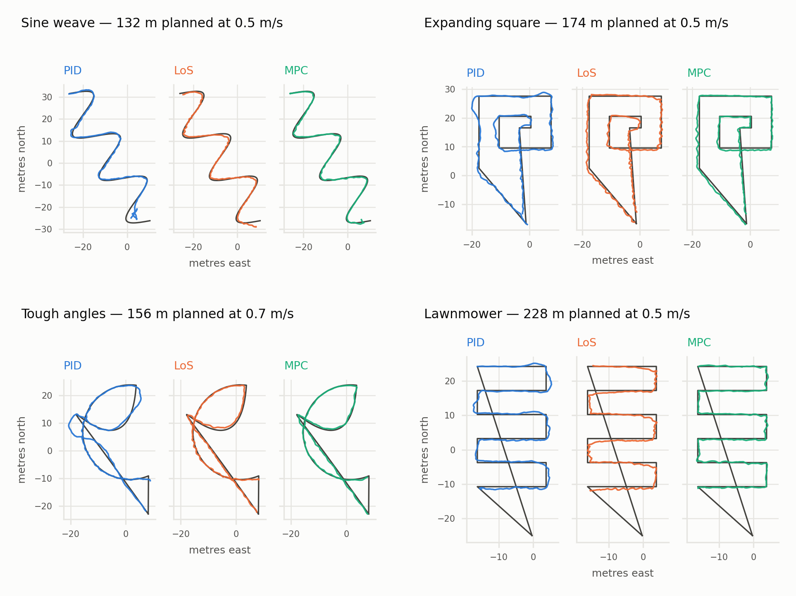
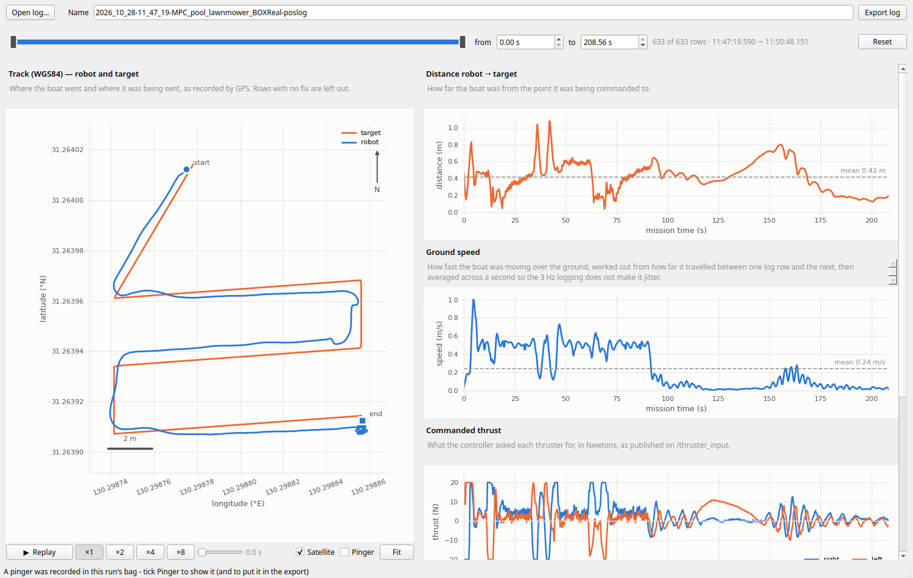

# BlueBoat-Control

The control stack of a [BlueRobotics BlueBoat](https://bluerobotics.com/store/boat/blueboat/blueboat/),
a small twin-hull uncrewed surface vessel (USV). This module makes the boat move. It follows a
path with one of three controllers, drives the two thrusters through the autopilot, and logs
every run. The same ROS 2 interface runs in the Gazebo simulator and on the real boat.



*Four routes flown on the water at a beach basin, once with each controller. The black line is
the planned path. The coloured line is where the boat really went. The closer they are, the
better the controller follows the path.*

## What you can do with it

- **Drive the boat along a path** with one of three controllers you choose at launch: model
  predictive control (MPC), proportional-integral-derivative (PID) or line of sight (LoS).
- **Fly built-in test shapes** (circle, square, sine, lawnmower...) or any survey path drawn in
  the Mission Control Station.
- **Simulate the boat in Gazebo** with a model identified from real field logs, so simulated and
  real runs can be compared.
- **Change the path while the boat moves** (the live path update). The Replanner uses this.
- **Log every run**: a position log, a report picture and, on the real boat, a ros2 bag.
- **Replay a recorded real run in Gazebo**, with the boat moving exactly as it did on the water.
- **Review a run on your desk** with the log reviewer app (below), without ROS.



*The log reviewer on a real run in a pool. On the left, the boat's track (blue) and the target it
was sent to (orange). On the right, how far the boat was from its target, its speed and the
thrust of each motor. The bar at the top trims the run.*

## How it connects to the other modules

```
sonar (BlueBoat-SSS) → Perception → Belief → Replanner → [ Control ] → boat
```

| Module | Link | Relation to Control |
|---|---|---|
| BlueBoat-MCS | [github.com/Kyyrron/BlueBoat-MCS](https://github.com/Kyyrron/BlueBoat-MCS) | The Mission Control Station (MCS) starts, watches and stops this stack |
| BlueBoat-Replanner | [github.com/Kyyrron/BlueBoat-Replanner](https://github.com/Kyyrron/BlueBoat-Replanner) | Sends new paths through the live path update `/blueboat/update_path` |
| BlueBoat-SSS | [github.com/Kyyrron/BlueBoat-SSS](https://github.com/Kyyrron/BlueBoat-SSS) | The sonar module; uses this module's message types and the boat's position |
| BlueBoat-SSS-Sim | [github.com/Kyyrron/BlueBoat-SSS-Sim](https://github.com/Kyyrron/BlueBoat-SSS-Sim) | Starts this stack inside generated Gazebo worlds with a simulated sonar and sea |
| BlueBoat-Belief | [github.com/Kyyrron/BlueBoat-Belief](https://github.com/Kyyrron/BlueBoat-Belief) | Reads the boat's position (`/blueboat/odom`) |
| Whole project | [github.com/Kyyrron/BlueBoat-SideScanSonar](https://github.com/Kyyrron/BlueBoat-SideScanSonar) | The superproject that holds every module |

This module also owns the package `blueboat_interfaces` (the shared message and service types),
so **build it first**.

**Where the software runs.** Every node runs on the operator laptop, in `~/ros2_ws`. The laptop
reaches the boat over the BlueBoat Base Station WiFi. The boat carries only its own hardware and
firmware: the BlueOS / ArduPilot autopilot (`192.168.2.2`), the sonars, GPS, compass and the
Water Linked underwater positioning system.

## Dependencies

| Dependency | Link | Quick install |
|---|---|---|
| Ubuntu 24.04 | [ubuntu.com](https://ubuntu.com/download/desktop) | |
| ROS 2 Jazzy | [docs.ros.org](https://docs.ros.org/en/jazzy/Installation/Ubuntu-Install-Debs.html) | `sudo apt install ros-jazzy-desktop` |
| Gazebo Harmonic and its ROS bridge | [gazebosim.org](https://gazebosim.org/docs/harmonic/ros_installation/) | `sudo apt install ros-jazzy-ros-gz` |
| ROS packages | apt | `sudo apt install ros-jazzy-xacro ros-jazzy-simple-launch ros-jazzy-slider-publisher ros-jazzy-mavros ros-jazzy-urdfdom-py` |
| `pose_to_tf` | [github.com/oKermorgant/pose_to_tf](https://github.com/oKermorgant/pose_to_tf) | clone into `~/ros2_ws/src` |
| Python packages | `requirements.txt` | `pip install -r requirements.txt` in the workspace venv |
| acados (the MPC solver) | [docs.acados.org](https://docs.acados.org/installation/index.html) | build from source, step 4 below |
| QGroundControl (optional) | [download](https://s3.amazonaws.com/downloads.bluerobotics.com/QGC/latest/QGroundControl.AppImage) | to watch the real boat's autopilot |

**acados is needed for every controller**, not only MPC: the control node loads it at start-up.

## Installation, step by step

```bash
# 1. ROS 2 Jazzy, Gazebo Harmonic and the ROS packages (table above), then:
sudo apt install ros-jazzy-xacro ros-jazzy-simple-launch ros-jazzy-slider-publisher \
                 ros-jazzy-mavros ros-jazzy-urdfdom-py ros-jazzy-ros-gz

# 2. Get the code. With the whole project (recommended):
mkdir -p ~/ros2_ws/src && cd ~/ros2_ws/src
git clone --recurse-submodules https://github.com/Kyyrron/BlueBoat-SideScanSonar.git
#    or this module alone:
#    git clone https://github.com/Kyyrron/BlueBoat-Control.git
git clone https://github.com/oKermorgant/pose_to_tf.git

# 3. Python environment (the venv every module shares)
cd ~/ros2_ws
python3 -m venv .venv && source .venv/bin/activate
pip install -r src/BlueBoat-SideScanSonar/requirements.txt   # or BlueBoat-Control/requirements.txt alone
```

**4. Build the acados C library.** `pip` installed only its Python part, in
`~/ros2_ws/.venv/src/acados-template/`. Build the library there with
[the acados CMake instructions](https://docs.acados.org/installation/index.html#installation-via-cmake),
then add these two lines to `~/.bashrc`:

```bash
export ACADOS_SOURCE_DIR=$HOME/ros2_ws/.venv/src/acados-template
export LD_LIBRARY_PATH=$ACADOS_SOURCE_DIR/lib:$LD_LIBRARY_PATH
```

acados also needs its template renderer in `$ACADOS_SOURCE_DIR/bin/t_renderer`. If it is missing,
the control node stops and prints the exact command that downloads it.

**5. Create `~/ros2_ws/env.sh`** (once), the file you source in every new terminal:

```bash
source .venv/bin/activate
source install/setup.bash
```

**6. Build**, always from the workspace root, in a terminal where only ROS is sourced:

```bash
cd ~/ros2_ws && source /opt/ros/jazzy/setup.bash
colcon build --packages-select blueboat_interfaces    # first: other modules use its types
colcon build
```

## Check the installation

```bash
cd ~/ros2_ws && source env.sh
ros2 launch blueboat_control Sim_launch.py controller_type:='PID' trajectory:='circle'
ros2 launch blueboat_control Sim_launch.py controller_type:='MPC' trajectory:='circle'
```

Gazebo opens and the boat drives a circle of 4 m radius. The first MPC launch compiles its
solver, which takes about a minute. Close Gazebo with `Ctrl+C` in the terminal.

The log reviewer needs no ROS:

```bash
cd ~/ros2_ws/src/BlueBoat-SideScanSonar/BlueBoat-Control
python3 log_reviewer/run.py            # then "Open log..."
```

## Tips: when to use it, what to know

- **Normally you do not start this module by hand.** The Mission Control Station launches it for
  real runs and simulations. Start it by hand to tune a controller or test one shape.
- **Nothing moves on the real boat unless you pass `enable_motors:=True`.** This is on purpose.
- **Send `default` before you stop a real-boat launch.** Otherwise the boat may stay in
  "override" and ignore the hand controller. The Mission Control Station does it for you:
  ```bash
  ros2 topic pub --once /blueboat/input_str std_msgs/msg/String "data: default"
  ```
- **QGroundControl and the autopilot link both use UDP port 14550.** Close QGroundControl, or the
  launch cannot connect.
- **Run one mission launch at a time.** A second one refuses to start.
- **A simulation is not the real boat.** In simulation MPC turns a little less and LoS a little
  more than the real boat. Use simulated runs to compare strategies, not as field numbers (the
  superproject's `SIM_VALIDITY_CONDITIONS.md`).
- **The live path update is tested in Gazebo only**, not yet on water.
- **Recorded runs are field data.** Never edit or overwrite anything in `~/ros2_ws/data/Robot_data/`.
- **After pulling new code, rebuild** (`colcon build`). An old build runs old code without warning.

## More documentation

| Document | What you find there |
|---|---|
| [docs/USER_GUIDE.md](docs/USER_GUIDE.md) | Every launch, launch argument, operator command, log file and the replay, in detail |
| [docs/DEVELOPMENT.md](docs/DEVELOPMENT.md) | How to work on this module: Claude Code, setup, tests, rules, next steps |
| [log_reviewer/README.md](log_reviewer/README.md) | The log reviewer app |
| [FIELD_TUNING.md](FIELD_TUNING.md) | Every controller setting, real and simulated defaults, which knob fixes which symptom |
| [blueboat_control/config/field_runs/README.md](blueboat_control/config/field_runs/README.md) | Re-flying a field day's controller settings in simulation |
| [controller_comparison/Controller_Report_BlueBoat.pdf](controller_comparison/Controller_Report_BlueBoat.pdf) | The field comparison of the three controllers |
| [blueboat_control/src/TRAJECTORY_SYSTEM.md](blueboat_control/src/TRAJECTORY_SYSTEM.md) | How the moving target along the path is built |
| [docs/PATH_UPDATE_INTERFACE.md](docs/PATH_UPDATE_INTERFACE.md) | The live path update, for programs that send paths |
| [docs/PATH_UPDATE_DESIGN.md](docs/PATH_UPDATE_DESIGN.md) | Why the live path update works the way it does |
| [docs/PATH_UPDATE_REAL_WATER_TEST.md](docs/PATH_UPDATE_REAL_WATER_TEST.md) | The protocol for its first test on water |
| [docs/PARAMETER_REGISTER.md](docs/PARAMETER_REGISTER.md) | Every number of the simulated boat and where it comes from |

---

## Authors

BERTRAND Killian, Kyushu Institute of Technology, 2026.
Yannick NOE

Released under the MIT License — see `LICENSE`.
